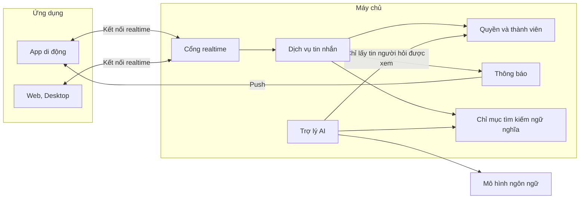

# Đề 8 · Nhắn tin nội bộ có AI

> **Mã:** DE08 · **Độ khó:** 8/8 · **Vai trò:** 3 (thành viên, quản trị workspace, trợ lý AI) · **Nền tảng:** App iOS / Android · Web / Desktop `[giả định]`

Công cụ nhắn tin cho công ty: kênh theo nhóm, tin nhắn 1-1, thread, gửi file, trạng thái đã xem, thông báo có kiểm soát. Có trợ lý AI tóm tắt kênh hoặc thread và trả lời câu hỏi dựa trên lịch sử tin nhắn mà **người hỏi có quyền xem**. Đây là đề khó nhất: **realtime nhiều thiết bị**, **thông báo không gây phiền**, và **thiết kế trải nghiệm cho AI** (độ tin cậy, trích nguồn, quyền dữ liệu). Đề gồm 5 tính năng; mỗi tính năng có 1 PRD và 1 SRS riêng.

## Tính năng

| **Mã** | **Tính năng** | **Phạm vi** | **PRD** | **SRS** |
| --- | --- | --- | --- | --- |
| TN01 | Workspace, kênh & thành viên | Tạo workspace, mời thành viên, vai trò, kênh công khai và riêng tư, tham gia, rời, lưu trữ kênh | [PRD](docs/TN01-workspace-kenh-thanh-vien/PRD.md) | [SRS](docs/TN01-workspace-kenh-thanh-vien/SRS.md) |
| TN02 | Nhắn tin realtime | Gửi tin trong kênh và 1-1, thread, file, sửa, xoá, reaction, đã xem, gửi khi mất mạng, đồng bộ nhiều thiết bị | [PRD](docs/TN02-nhan-tin-realtime/PRD.md) | [SRS](docs/TN02-nhan-tin-realtime/SRS.md) |
| TN03 | Thông báo & trạng thái online | Mention, cài đặt thông báo theo kênh, giờ yên lặng, gom thông báo, trạng thái online, trạng thái tuỳ chỉnh | [PRD](docs/TN03-thong-bao-trang-thai/PRD.md) | [SRS](docs/TN03-thong-bao-trang-thai/SRS.md) |
| TN04 | AI tóm tắt kênh / thread | Tóm tắt tin chưa đọc, tóm tắt thread, việc cần làm, quyết định, trích dẫn tin gốc, phản hồi chất lượng | [PRD](docs/TN04-ai-tom-tat/PRD.md) | [SRS](docs/TN04-ai-tom-tat/SRS.md) |
| TN05 | AI hỏi đáp trên lịch sử | Hỏi bằng ngôn ngữ tự nhiên, tìm kiếm ngữ nghĩa, câu trả lời có nguồn, chỉ trong phạm vi quyền của người hỏi, nói rõ khi không biết | [PRD](docs/TN05-ai-hoi-dap/PRD.md) | [SRS](docs/TN05-ai-hoi-dap/SRS.md) |

Thứ tự làm gợi ý: TN01 → TN02 → TN03 → TN04 → TN05.

## Kiến trúc tổng thể



Nguyên tắc dữ liệu cho AI: **trợ lý không bao giờ đọc được nhiều hơn người hỏi**. Mọi truy vấn của AI tới kho tin nhắn đều đi qua bộ lọc quyền của người đang hỏi (TN04, TN05).

## Bối cảnh chung

Công ty 50–500 người dùng nhắn tin cho công việc. Vấn đề thường gặp: quá nhiều kênh và thông báo, đi họp hoặc nghỉ phép về thấy hàng trăm tin chưa đọc, thông tin quan trọng chìm trong cuộc trò chuyện, hỏi lại điều đã trả lời từ tuần trước. AI giúp đọc nhanh và tìm lại, nhưng chỉ có ích nếu người dùng **tin** câu trả lời và biết nó đến từ đâu.

| **Nhóm người dùng** | **Nhu cầu chính** |
| --- | --- |
| Nhân viên | Theo kịp các kênh liên quan, không bị thông báo làm phiền |
| Quản lý | Nắm quyết định, việc cần làm trong nhiều kênh mà không đọc hết |
| Người mới vào | Tìm lại bối cảnh, câu trả lời đã có |
| Quản trị workspace | Mời, quản lý thành viên, kênh; kiểm soát dữ liệu và AI |

Ngoài phạm vi cả đề: gọi thoại, video, chia sẻ màn hình; tìm kiếm tin nhắn theo từ khoá (chỉ có tìm kênh ở TN01 và AI hỏi đáp ở TN05); tích hợp ứng dụng bên ngoài (bot, webhook); kết nối nhiều workspace; tuân thủ lưu trữ pháp lý (eDiscovery); AI tự động trả lời thay người dùng; AI đọc nội dung file đính kèm (MVP chỉ tên file).

## Quy ước dùng chung

- Màn hình mã `SCR-..` dùng chung cho App và Web; khác biệt ghi trong từng SRS.
- "Hội thoại" gồm kênh (công khai, riêng tư) và tin nhắn trực tiếp (1-1, nhóm nhỏ).
- Đăng nhập bằng email công ty và SSO hoặc mã đăng nhập, không mô tả trong bộ tài liệu này.
- Mã BR, MSG, UC đánh số liên tục trong cả đề: TN01 dùng BR-01–14, MSG-01–12; TN02 dùng BR-15–30, MSG-13–24; TN03 dùng BR-31–42, MSG-25–32; TN04 dùng BR-43–55, MSG-33–42; TN05 dùng BR-56–70, MSG-43–54. Mã bổ sung sau đánh tiếp từ số cuối: MSG-55 (xác nhận đánh dấu đã đọc khi tóm tắt bị cắt) ở SRS TN04; BR-71 (thời gian lưu tin), MSG-56 ở SRS TN01.
- Giá trị đánh dấu `[giả định]` dùng để dựng flow, cần PO hoặc BA xác nhận trước khi dùng.

## Danh sách màn hình

| **Mã** | **Màn hình** | **Mô tả chi tiết ở** |
| --- | --- | --- |
| SCR-01 | Tạo workspace, mời thành viên | SRS TN01 |
| SCR-02 | Thanh bên: kênh, tin nhắn trực tiếp | SRS TN01 |
| SCR-03 | Duyệt và tạo kênh | SRS TN01 |
| SCR-04 | Thông tin kênh, thành viên | SRS TN01 |
| SCR-05 | Quản trị workspace | SRS TN01 |
| SCR-06 | Hội thoại | SRS TN02 |
| SCR-07 | Thread | SRS TN02 |
| SCR-08 | Ô soạn tin | SRS TN02 |
| SCR-09 | Hoạt động (mention, trả lời) | SRS TN03 |
| SCR-10 | Cài đặt thông báo | SRS TN03 |
| SCR-11 | Hồ sơ, trạng thái | SRS TN03 |
| SCR-12 | Bảng tóm tắt AI | SRS TN04 |
| SCR-13 | Hỏi trợ lý AI | SRS TN05 |

## Cấu trúc repo

```text
de08-nhan-tin-noi-bo-ai/
├── README.md
└── docs/
    ├── TN01-workspace-kenh-thanh-vien/   PRD.md · SRS.md
    ├── TN02-nhan-tin-realtime/           PRD.md · SRS.md
    ├── TN03-thong-bao-trang-thai/        PRD.md · SRS.md
    ├── TN04-ai-tom-tat/                  PRD.md · SRS.md
    └── TN05-ai-hoi-dap/                  PRD.md · SRS.md
```

## Cách dùng bộ tài liệu

1. Đọc README để nắm kiến trúc và nguyên tắc dữ liệu cho AI.
2. Với mỗi tính năng: đọc PRD, rồi SRS. Với tin nhắn, luôn nghĩ tới **nhiều thiết bị** và **mạng chập chờn**; với AI, luôn thiết kế trạng thái **đang tạo, không chắc chắn, không có dữ liệu, lỗi**.
3. Thiết kế màn hình theo đúng mã SCR, mã MSG trong SRS để dễ đối chiếu khi review.
4. Sơ đồ viết bằng Mermaid, xem trực tiếp trên GitHub hoặc trình xem Markdown có hỗ trợ Mermaid.
