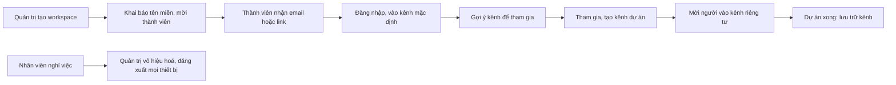

> **Mã:** DE08-TN01-PRD · **Trạng thái:** nháp · **Người viết:** Design (mock) · **SRS:** [SRS.md](SRS.md)

# PRD Workspace, kênh và thành viên (Nhắn tin nội bộ có AI)

> **Bản mock.** Con số đánh dấu `[giả định]` dùng để dựng flow, cần PO xác nhận trước khi dùng.

## 1. Bối cảnh và vấn đề

### 1.1 Bối cảnh

Mỗi công ty có một workspace. Trong workspace, cuộc trò chuyện chia thành kênh theo nhóm, dự án, chủ đề. Cách tổ chức kênh và quyền thành viên quyết định ai thấy được gì: điều này không chỉ ảnh hưởng tới người dùng, mà còn quyết định trợ lý AI được phép đọc gì cho từng người ([TN04](../TN04-ai-tom-tat/PRD.md), [TN05](../TN05-ai-hoi-dap/PRD.md)).

### 1.2 Vấn đề

| **Vấn đề** | **Hệ quả** |
| --- | --- |
| Mời đồng nghiệp phức tạp, phải tạo tài khoản từng người | Chậm triển khai, nhiều người không dùng |
| Kênh mọc tràn lan, trùng tên | Không biết vào kênh nào, tin bị tách rời |
| Không phân biệt kênh công khai và riêng tư rõ ràng | Lỡ chia sẻ thông tin nhạy cảm cho người không liên quan |
| Người nghỉ việc vẫn còn quyền | Rủi ro lộ dữ liệu |
| Kênh dự án đã xong vẫn hiện | Thanh bên rối mắt |

### 1.3 Mục tiêu

- Workspace mới có ≥ 10 thành viên hoạt động trong 7 ngày `[giả định]`.
- Thành viên mới tham gia kênh đầu tiên trong ≤ 2 phút sau khi đăng nhập `[giả định]`.
- Gỡ quyền thành viên rời công ty có hiệu lực trên mọi thiết bị trong ≤ 1 phút `[giả định]`.

## 2. Người dùng

| **Nhóm** | **Nhu cầu với tính năng này** |
| --- | --- |
| Quản trị workspace | Mời theo email, tên miền; vai trò; vô hiệu hoá thành viên; chính sách kênh, AI |
| Nhân viên | Tìm và tham gia kênh liên quan; tạo kênh dự án; mời người khác |
| Khách (đối tác bên ngoài) | Chỉ vào được kênh được mời |

## 3. Phạm vi

### 3.1 Trong phạm vi (MVP)

- Tạo workspace: tên, đường dẫn, tên miền email công ty.
- Mời thành viên: email, link mời có hạn, tự tham gia bằng email cùng tên miền.
- Vai trò: Chủ sở hữu, Quản trị, Thành viên, Khách.
- Kênh công khai, kênh riêng tư; mô tả, chủ đề; kênh mặc định cho người mới.
- Duyệt, tìm, tham gia, rời kênh; mời vào kênh; xoá khỏi kênh.
- Lưu trữ kênh; chuyển kênh công khai thành riêng tư.
- Vô hiệu hoá thành viên.
- Cài đặt AI của workspace: bật, tắt; loại trừ kênh khỏi AI.

### 3.2 Ngoài phạm vi

- Nhiều workspace liên kết, kênh chia sẻ giữa công ty.
- Đồng bộ thành viên tự động từ hệ thống nhân sự (SCIM) → phase sau.
- Nhóm người dùng (@nhom-thiet-ke).
- Chuyển kênh riêng tư thành công khai.

## 4. Nguyên tắc sản phẩm

### 4.1 Mở mặc định, riêng tư khi cần

Kênh công khai là mặc định để thông tin dễ tìm. Kênh riêng tư có biểu tượng khoá ở mọi nơi.

### 4.2 Quyền là ranh giới duy nhất

Ai không phải thành viên kênh riêng tư thì không thấy tên kênh, tin nhắn, kết quả tìm kiếm hay câu trả lời AI liên quan tới kênh đó.

### 4.3 Vào là có việc

Người mới tự vào kênh mặc định và được gợi ý kênh theo nhóm, để không bắt đầu với màn hình trống.

### 4.4 Gọn gàng theo thời gian

Kênh đã xong được lưu trữ thay vì xoá, vẫn đọc và tìm được.

## 5. Quy tắc nghiệp vụ

| **Quy tắc** | **Giá trị** `[giả định]` |
| --- | --- |
| Tên kênh | 1–80 ký tự, chữ thường, số, gạch ngang; không trùng trong workspace |
| Link mời | Hết hạn sau 7 ngày, tối đa 100 lượt dùng |
| Tự tham gia | Email cùng tên miền đã khai báo (bật, tắt được) |
| Kênh mặc định | #chung và tối đa 3 kênh do quản trị chọn |
| Khách | Chỉ thấy kênh được mời; không tạo kênh; không dùng AI |
| Vô hiệu hoá | Đăng xuất mọi thiết bị, giữ tin nhắn cũ, hiện "(đã vô hiệu hoá)" |
| Chuyển công khai → riêng tư | Chỉ quản trị; thành viên hiện tại giữ quyền; không đảo ngược |
| Loại trừ khỏi AI | Quản trị chọn kênh; tin nhắn kênh đó không được AI đọc |

- Các giá trị trên là **cấu hình theo workspace**, không cố định trong code.

## 6. Luồng trải nghiệm

| **Bước** | **Giai đoạn** | **Trải nghiệm** | **Đầu ra** |
| --- | --- | --- | --- |
| 1 | Tạo workspace | Tên công ty, đường dẫn, tên miền email | Workspace |
| 2 | Mời | Dán danh sách email, hoặc tạo link mời | Lời mời |
| 3 | Tham gia | Bấm link, đăng nhập; tự vào #chung và kênh mặc định | Thành viên |
| 4 | Tìm kênh | Duyệt kênh công khai, gợi ý theo phòng ban | Tham gia kênh |
| 5 | Tạo kênh | Tên, mô tả, công khai hoặc riêng tư, mời người | Kênh mới |
| 6 | Quản lý | Lưu trữ kênh, vô hiệu hoá thành viên, cài đặt AI | Workspace gọn, an toàn |

## 7. Use Cases, User Stories và Acceptance Criteria

### UC1. Workspace và lời mời

#### US1.1 Tạo workspace và mời

User Story: Là quản trị, tôi muốn mời cả công ty nhanh chóng để mọi người cùng bắt đầu.

AC01: Tạo workspace với tên, đường dẫn (duy nhất), tên miền email.

AC02: Mời bằng danh sách email (dán nhiều email), chọn vai trò Thành viên hoặc Khách.

AC03: Link mời có hạn 7 ngày, tối đa 100 lượt; thu hồi được.

AC04: Bật tự tham gia cho email cùng tên miền.

AC05: Danh sách lời mời: đã gửi, đã chấp nhận, hết hạn; gửi lại được.

### UC2. Kênh

#### US2.1 Tạo và tham gia kênh

User Story: Là nhân viên, tôi muốn tạo kênh cho dự án và mời đúng người.

AC01: Tạo kênh: tên (gợi ý chuẩn hoá), mô tả, công khai hoặc riêng tư (mặc định công khai), mời thành viên.

AC02: Tên trùng → báo lỗi và gợi ý tên khác; tên trùng kênh đã lưu trữ → gợi ý khôi phục.

AC03: Duyệt kênh công khai: tên, mô tả, số thành viên, hoạt động gần nhất; tham gia một chạm.

AC04: Kênh riêng tư chỉ hiện với thành viên; vào bằng lời mời.

AC05: Rời kênh bất kỳ lúc nào trừ #chung.

#### US2.2 Quản lý kênh

User Story: Là người tạo kênh hoặc quản trị, tôi muốn sửa thông tin và lưu trữ kênh để danh sách kênh gọn, đúng mục đích.

AC01: Người tạo kênh và quản trị sửa tên, mô tả, chủ đề.

AC02: Lưu trữ kênh → không gửi tin mới, vẫn đọc và tìm được; khôi phục được.

AC03: Chuyển công khai thành riêng tư (chỉ quản trị), có cảnh báo không đảo ngược.

### UC3. Thành viên và vai trò

AC01: Quản trị đổi vai trò; Chủ sở hữu không bị hạ vai trò bởi Quản trị.

AC02: Vô hiệu hoá → đăng xuất mọi thiết bị ≤ 1 phút; tin nhắn cũ giữ nguyên tên kèm "(đã vô hiệu hoá)".

AC03: Khách chỉ thấy kênh được mời, có nhãn "Khách" bên cạnh tên.

### UC4. Cài đặt AI của workspace

AC01: Quản trị bật, tắt trợ lý AI cho workspace.

AC02: Chọn kênh loại trừ khỏi AI; kênh đó có biểu tượng "AI không đọc".

AC03: Khách không dùng AI.

## 8. Chỉ số theo dõi `[giả định]`

| **Chỉ số** | **Định nghĩa** | **Mục tiêu MVP** |
| --- | --- | --- |
| Thành viên hoạt động 7 ngày | Thành viên gửi ≥ 1 tin trong 7 ngày đầu | ≥ 10 mỗi workspace |
| Tỉ lệ chấp nhận lời mời | Lời mời được chấp nhận / lời mời gửi | ≥ 70% |
| Thời gian tới kênh đầu tiên | Từ đăng nhập lần đầu tới tham gia kênh ngoài mặc định | ≤ 2 phút |
| Tỉ lệ kênh riêng tư | Kênh riêng tư / tổng kênh | Theo dõi |
| Kênh không hoạt động | Kênh không có tin 30 ngày, chưa lưu trữ | Theo dõi, gợi ý lưu trữ |

## 9. Phụ thuộc và rủi ro

| **Mục** | **Mô tả** | **Hướng xử lý** |
| --- | --- | --- |
| Lộ kênh riêng tư | Tên kênh hiện ở tìm kiếm, gợi ý, AI | Bộ lọc quyền dùng chung cho mọi tính năng |
| Link mời bị chia sẻ ra ngoài | Người lạ vào workspace | Hạn 7 ngày, giới hạn lượt, thu hồi; tự tham gia chỉ theo tên miền |
| Vô hiệu hoá chậm | Người đã nghỉ vẫn đọc tin | Thu hồi phiên ngay, kết nối realtime bị ngắt |
| Kênh trùng chủ đề | Thông tin rời rạc | Gợi ý kênh có sẵn khi tạo kênh tên gần giống |

## 10. Câu hỏi mở

- Thành viên có được tạo kênh riêng tư không, hay chỉ quản trị?
- Khách có được nhắn tin 1-1 với thành viên ngoài kênh chung?
- Có giới hạn số kênh mỗi workspace?
- Mặc định AI bật hay tắt khi tạo workspace?
