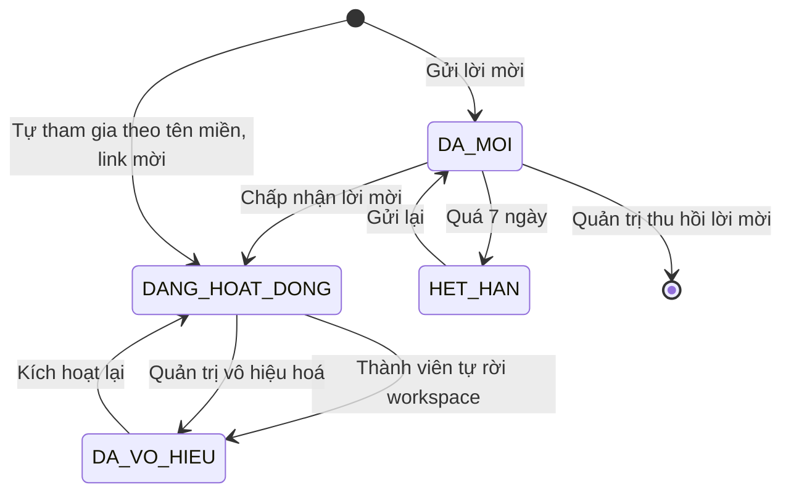
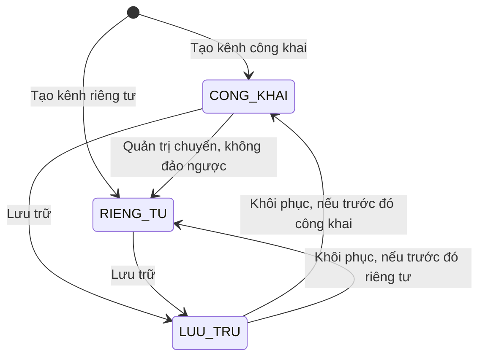
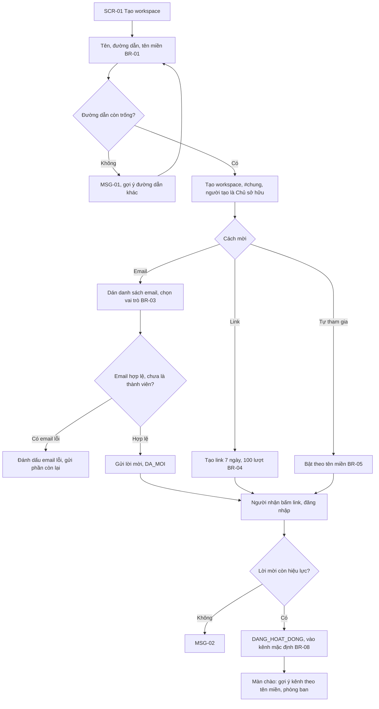
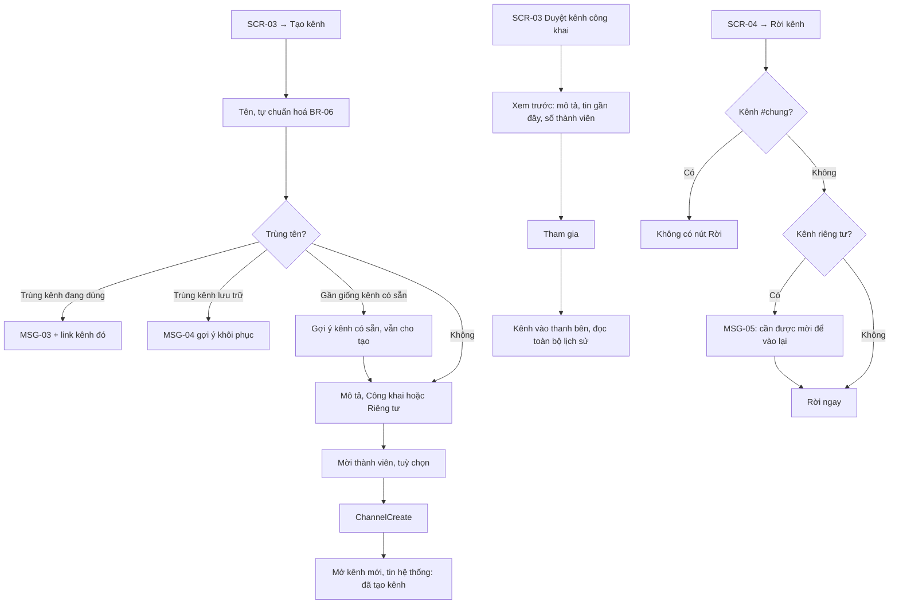
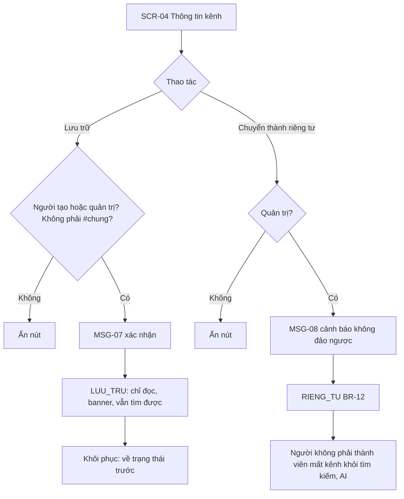
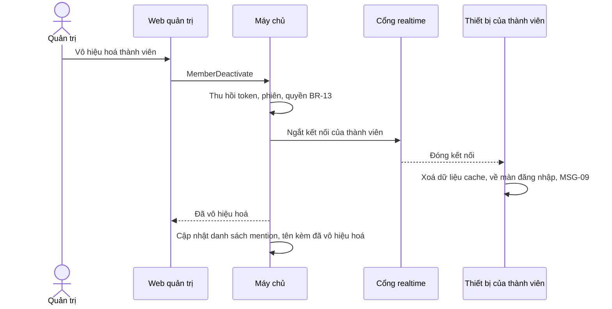

> **Mã:** DE08-TN01-SRS · **Trạng thái:** nháp · **Người viết:** Design (mock) · **PRD:** [PRD.md](PRD.md)

# UC-DE08-01 - Workspace, kênh và thành viên

> **Bản mock.** Giá trị `[giả định]` cần BA xác nhận. Quy tắc quyền ở đây được TN02–TN05 dùng lại; đặc biệt BR-10 là nền cho quyền đọc của AI.

## 1. Tổng quan

| **Mục** | **Nội dung** |
| --- | --- |
| Mục tiêu | Tạo workspace, mời và quản lý thành viên, tạo và quản lý kênh, đặt ranh giới quyền và cài đặt AI |
| Actor | Chủ sở hữu · Quản trị · Thành viên · Khách · App, Web · Máy chủ · Dịch vụ email |
| Phạm vi | Workspace, lời mời, tự tham gia, vai trò, kênh công khai, riêng tư, mặc định, tham gia, rời, mời, xoá khỏi kênh, lưu trữ, vô hiệu hoá, cài đặt AI |
| Ngoài phạm vi | Liên kết workspace, SCIM, nhóm người dùng, riêng tư → công khai |
| Nền tảng | App iOS / Android, Web / Desktop `[giả định]` |
| Figma | `[chưa có]` |

## 2. User Story

| **ID** | **As a** | **I want** | **So that** |
| --- | --- | --- | --- |
| US-01 | Quản trị | Mời nhiều người bằng email hoặc link | Triển khai nhanh |
| US-02 | Thành viên mới | Vào là có kênh và gợi ý | Không bắt đầu với màn hình trống |
| US-03 | Thành viên | Tạo kênh công khai hoặc riêng tư | Tổ chức trao đổi theo dự án |
| US-04 | Thành viên | Tìm và tham gia kênh công khai | Theo dõi chủ đề liên quan |
| US-05 | Quản trị | Vô hiệu hoá người nghỉ việc ngay | Bảo vệ dữ liệu |
| US-06 | Quản trị | Bật, tắt AI và loại trừ kênh | Kiểm soát dữ liệu AI đọc |

## 3. Business Rules

| **Mã** | **Quy tắc** |
| --- | --- |
| BR-01 | **Workspace**: tên 2–50 ký tự; đường dẫn 3–30 ký tự (chữ thường, số, gạch ngang), duy nhất toàn hệ thống; 0–3 tên miền email công ty |
| BR-02 | **Vai trò**: `CHU_SO_HUU` (1 người, chuyển nhượng được), `QUAN_TRI`, `THANH_VIEN`, `KHACH`. Quản trị không đổi vai trò Chủ sở hữu, không vô hiệu hoá Chủ sở hữu |
| BR-03 | **Lời mời email**: vai trò Thành viên hoặc Khách (Khách phải chọn ≥ 1 kênh); hết hạn 7 ngày; gửi lại tạo mã mới, vô hiệu mã cũ |
| BR-04 | **Link mời**: vai trò Thành viên; hết hạn 7 ngày hoặc 100 lượt; quản trị thu hồi được |
| BR-05 | **Tự tham gia**: bật, tắt; email đã xác minh thuộc tên miền khai báo → vào với vai trò Thành viên, không cần lời mời |
| BR-06 | **Kênh**: tên 1–80 ký tự, chữ thường, số, gạch ngang (tự chuẩn hoá khi gõ: bỏ dấu, khoảng trắng → gạch ngang); duy nhất trong workspace kể cả kênh lưu trữ; mô tả ≤ 250 ký tự |
| BR-07 | **Loại kênh**: `CONG_KHAI` (mọi Thành viên thấy, tự tham gia), `RIENG_TU` (chỉ thành viên kênh thấy, vào bằng lời mời). Khách không tự tham gia kênh công khai |
| BR-08 | **Kênh mặc định**: #chung (không rời được, không lưu trữ được) và tối đa 3 kênh công khai do quản trị chọn; người mới tự tham gia |
| BR-09 | **Quyền tạo kênh**: Thành viên tạo kênh công khai và riêng tư `[giả định]`; Khách không tạo kênh |
| BR-10 | **Quyền xem hội thoại** (`can_view(user, conversation)`): công khai → user là Thành viên trở lên của workspace, hoặc là Khách đã được mời vào kênh; riêng tư và tin nhắn trực tiếp → user là thành viên hội thoại. Áp dụng cho danh sách kênh, tin nhắn, tìm kiếm, thông báo, AI |
| BR-11 | **Lưu trữ kênh**: người tạo kênh hoặc quản trị; kênh `LUU_TRU` chỉ đọc, vẫn tìm kiếm được; thành viên giữ nguyên; khôi phục được |
| BR-12 | **Công khai → riêng tư**: chỉ quản trị; thành viên hiện tại giữ nguyên; không đảo ngược. Tin nhắn cũ trước thời điểm chuyển chỉ còn thành viên kênh thấy |
| BR-13 | **Vô hiệu hoá thành viên**: thu hồi mọi phiên, ngắt kết nối realtime ≤ 1 phút; giữ tin nhắn, hiện tên kèm "(đã vô hiệu hoá)"; không còn trong danh sách mention, tìm người |
| BR-14 | **Cài đặt AI** (quản trị): `ai_enabled` của workspace; danh sách kênh `ai_excluded`. Khách luôn không dùng AI. AI chỉ đọc hội thoại thoả BR-10 với người hỏi **và** không thuộc `ai_excluded` |

## 4. Trạng thái

### 4.1 Thành viên workspace

### 4.2 Kênh

| **Trạng thái kênh** | **Thành viên kênh** | **Thành viên workspace khác** |
| --- | --- | --- |
| `CONG_KHAI` | Đọc, gửi | Thấy trong danh sách, xem trước, tham gia |
| `RIENG_TU` | Đọc, gửi | Không thấy tên kênh |
| `LUU_TRU` | Đọc, không gửi; banner "Đã lưu trữ" | Như trước khi lưu trữ, chỉ đọc |

## 5. Use Case

### UC-01 Tạo workspace và mời thành viên

| **Mục** | **Nội dung** |
| --- | --- |
| Tiền điều kiện | Người tạo đã đăng nhập bằng email công ty |
| Hậu điều kiện | Thành công: workspace và #chung được tạo, người tạo là Chủ sở hữu; người được mời ở `DA_MOI` hoặc `DANG_HOAT_DONG`. Thất bại: không tạo workspace |

**Luồng chính**

| **Bước** | **Actor** | **Mô tả** |
| --- | --- | --- |
| 1 | Người tạo | Mở **SCR-01**, nhập tên, đường dẫn, tên miền email (BR-01) |
| 2 | Hệ thống | Kiểm tra đường dẫn còn trống; tạo workspace và #chung, người tạo là Chủ sở hữu |
| 3 | Người tạo | Mời bằng email: dán danh sách email, chọn vai trò (BR-03) |
| 4 | Hệ thống | Gửi lời mời, tạo bản ghi `DA_MOI` |
| 5 | Người được mời | Bấm link trong email, đăng nhập |
| 6 | Hệ thống | Lời mời còn hiệu lực → thành viên `DANG_HOAT_DONG`, vào các kênh mặc định (BR-08) |
| 7 | Hệ thống | Hiện màn chào kèm gợi ý kênh |

**Luồng thay thế**

| **Mã** | **Điều kiện** | **Xử lý** |
| --- | --- | --- |
| A1 | Quản trị thu hồi lời mời email chưa được chấp nhận | Ở **SCR-05**, dòng lời mời `DA_MOI` có nút Thu hồi; mã mời vô hiệu ngay, người nhận bấm link thấy MSG-02 |
| A2 | Thành viên tự rời workspace | Hồ sơ → Rời workspace, hỏi xác nhận; xử lý như vô hiệu hoá (BR-13), muốn vào lại cần lời mời mới. Chủ sở hữu phải chuyển nhượng quyền trước khi rời (BR-02) |
| A3 | Người được mời đã là thành viên bị vô hiệu hoá | Không gửi lời mời; gợi ý quản trị Kích hoạt lại ở **SCR-05** |
| A4 | Mời bằng link | Tạo link có hạn 7 ngày, 100 lượt (BR-04) |
| A5 | Bật Tự tham gia theo tên miền | Người có email đúng tên miền tự vào được (BR-05) |
| A6 | Danh sách có email lỗi | Đánh dấu email lỗi, vẫn gửi phần còn lại (MSG-12) |

**Luồng lỗi**

| **Mã** | **Điều kiện** | **Xử lý** |
| --- | --- | --- |
| E1 | Đường dẫn đã có người dùng | MSG-01 kèm gợi ý đường dẫn khác |
| E2 | Lời mời hết hạn hoặc bị thu hồi | MSG-02 |

### UC-02 Tạo, tham gia, rời kênh

| **Mục** | **Nội dung** |
| --- | --- |
| Tiền điều kiện | Người dùng là Thành viên trở lên |
| Hậu điều kiện thành công | Kênh được tạo, hoặc người dùng là thành viên kênh |
| Hậu điều kiện thất bại | Không thay đổi |

**Luồng chính (tạo kênh)**

| **Bước** | **Actor** | **Mô tả** |
| --- | --- | --- |
| 1 | Thành viên | Thanh bên → "+" → Tạo kênh |
| 2 | App | Chuẩn hoá tên khi gõ (BR-06); kiểm tra trùng |
| 3 | Thành viên | Nhập mô tả, chọn loại (mặc định Công khai), mời thành viên |
| 4 | App | \[ChannelCreate\] |
| 5 | Máy chủ | Tạo kênh, thêm người tạo và người được mời; đẩy sự kiện tới thiết bị của họ |
| 6 | App | Mở **SCR-06** của kênh mới |

**Luồng thay thế**

| **Mã** | **Điều kiện** | **Xử lý** |
| --- | --- | --- |
| A1 | Mời vào kênh riêng tư người chưa thuộc workspace | Không cho; gợi ý mời vào workspace trước |
| A2 | Khách bấm tạo kênh | Không có nút (BR-09) |
| A3 | Xoá người khỏi kênh | Người tạo kênh hoặc quản trị; người bị xoá nhận MSG-06, kênh riêng tư biến mất khỏi thiết bị |

### UC-03 Lưu trữ, chuyển loại kênh

| **Mục** | **Nội dung** |
| --- | --- |
| Tiền điều kiện | Kênh `CONG_KHAI` hoặc `RIENG_TU`; người thao tác là người tạo kênh hoặc quản trị (chuyển loại: chỉ quản trị) |
| Hậu điều kiện | Kênh `LUU_TRU` chỉ đọc, hoặc kênh thành `RIENG_TU` và không đảo ngược được |

**Luồng chính**

| **Bước** | **Actor** | **Mô tả** |
| --- | --- | --- |
| 1 | Người tạo kênh hoặc quản trị | Mở **SCR-04** Thông tin kênh, chọn Lưu trữ |
| 2 | Hệ thống | MSG-07 hỏi xác nhận |
| 3 | Người tạo kênh hoặc quản trị | Xác nhận |
| 4 | Hệ thống | Kênh `LUU_TRU`: chỉ đọc, có banner, vẫn tìm kiếm được |

**Luồng thay thế**

| **Mã** | **Điều kiện** | **Xử lý** |
| --- | --- | --- |
| A1 | Khôi phục kênh đã lưu trữ | Kênh về trạng thái trước khi lưu trữ |
| A2 | Quản trị chọn Chuyển thành riêng tư | MSG-08 cảnh báo không đảo ngược → kênh `RIENG_TU` (BR-12); người không phải thành viên mất kênh khỏi tìm kiếm và phạm vi AI |

**Luồng lỗi**

| **Mã** | **Điều kiện** | **Xử lý** |
| --- | --- | --- |
| E1 | Không đủ quyền, hoặc kênh là #chung | Ẩn nút Lưu trữ, Chuyển thành riêng tư |

### UC-04 Vô hiệu hoá thành viên

| **Mục** | **Nội dung** |
| --- | --- |
| Tiền điều kiện | Quản trị; thành viên đích không phải Chủ sở hữu |
| Hậu điều kiện | Thành viên `DA_VO_HIEU`; mọi phiên bị thu hồi ≤ 1 phút |

**Luồng chính**

| **Bước** | **Actor** | **Mô tả** |
| --- | --- | --- |
| 1 | Quản trị | Ở **SCR-05**, chọn thành viên, bấm Vô hiệu hoá |
| 2 | Hệ thống | Gọi \[MemberUpdate\]; thu hồi token, phiên, quyền (BR-13) |
| 3 | Hệ thống | Cổng realtime ngắt mọi kết nối của thành viên |
| 4 | Hệ thống | Thiết bị của thành viên xoá dữ liệu cache, về màn đăng nhập, hiện MSG-09 |
| 5 | Hệ thống | Cập nhật danh sách mention; tên hiện kèm "đã vô hiệu hoá" |

**Luồng thay thế**

| **Mã** | **Điều kiện** | **Xử lý** |
| --- | --- | --- |
| A1 | Kích hoạt lại | Thành viên về `DANG_HOAT_DONG`, đăng nhập lại được |
| A2 | Thành viên tự rời workspace | Xử lý như vô hiệu hoá; muốn vào lại cần lời mời mới |

**Luồng lỗi**

| **Mã** | **Điều kiện** | **Xử lý** |
| --- | --- | --- |
| E1 | Thành viên đích là Chủ sở hữu | Không có nút Vô hiệu hoá; phải chuyển nhượng quyền trước (BR-02) |

### UC-05 Cài đặt AI

| **Mục** | **Nội dung** |
| --- | --- |
| Tiền điều kiện | Người thao tác là quản trị workspace |
| Hậu điều kiện | `ai_enabled` và danh sách `ai_excluded` được lưu; AI ngừng đọc kênh bị loại trừ (BR-14) |

**Luồng chính**

| **Bước** | **Actor** | **Mô tả** |
| --- | --- | --- |
| 1 | Quản trị | **SCR-05** → Trợ lý AI |
| 2 | Quản trị | Bật, tắt AI cho workspace; chọn kênh loại trừ |
| 3 | Máy chủ | Lưu `ai_enabled`, `ai_excluded` (BR-14); xoá dữ liệu chỉ mục của kênh loại trừ khỏi phạm vi AI ≤ 5 phút |
| 4 | App | Kênh loại trừ hiện biểu tượng "AI không đọc" ở **SCR-04**; nút AI ẩn khi `ai_enabled = false` |

## 6. Điểm vào

| **Điểm vào** | **Web** | **App** | **Dẫn tới** | **Ghi chú** |
| --- | --- | --- | --- | --- |
| Trang đăng ký → Tạo workspace | ✓ | ✓ | UC-01, **SCR-01** |  |
| Email mời, link mời | ✓ | ✓ | UC-01 (tham gia) |  |
| Thanh bên **SCR-02** → "+" | ✓ | ✓ | UC-02 tạo kênh |  |
| Thanh bên → Duyệt kênh | ✓ | ✓ | **SCR-03** |  |
| Tên kênh ở đầu **SCR-06** | ✓ | ✓ | **SCR-04** |  |
| Hồ sơ → Quản trị workspace | ✓ | ✓ | **SCR-05**, UC-04, UC-05 | Chỉ quản trị |

## 7. Mô tả màn hình

### SCR-01 Tạo workspace, mời thành viên

| **#** | **Thành phần** | **Loại** | **Hành vi** |
| --- | --- | --- | --- |
| 1 | Tên workspace | Text | 2–50 ký tự (BR-01) |
| 2 | Đường dẫn | Text có tiền tố | Tự gợi ý từ tên; kiểm tra trùng khi gõ; trùng → MSG-01 kèm gợi ý |
| 3 | Tên miền email công ty | Chips nhập | 0–3 tên miền (BR-01); dùng cho Tự tham gia (BR-05) |
| 4 | Tạo workspace | Button | Disabled tới khi mục 1, 2 hợp lệ |
| 5 | Mời bằng email | Ô dán nhiều email + chọn vai trò | BR-03; email lỗi được đánh dấu, phần còn lại vẫn gửi |
| 6 | Link mời | Button sao chép | Hiện hạn 7 ngày, 100 lượt (BR-04) |
| 7 | Tự tham gia theo tên miền | Toggle | Chỉ bật được khi đã khai báo tên miền (BR-05) |
| 8 | Bỏ qua, mời sau | Button text | Vào thẳng #chung; mời tiếp ở **SCR-05** |

Màn chia 2 bước: tạo workspace (mục 1–4), rồi mời thành viên (mục 5–8).

### SCR-02 Thanh bên

| **#** | **Thành phần** | **Loại** | **Hành vi** |
| --- | --- | --- | --- |
| 1 | Tên workspace | Header | Menu: Mời người, Cài đặt, Quản trị (nếu có quyền) |
| 2 | Lối tắt | List | Hoạt động (TN03), Tóm tắt AI (TN04), Hỏi AI (TN05) |
| 3 | Kênh | List | Tên kênh, biểu tượng khoá (riêng tư), in đậm khi có tin chưa đọc, badge mention |
| 4 | Tin nhắn trực tiếp | List | Ảnh, tên, chấm trạng thái (TN03) |
| 5 | "+" | Button | Tạo kênh, Duyệt kênh, Nhắn tin mới |

### SCR-03 Duyệt và tạo kênh

| **#** | **Thành phần** | **Loại** | **Hành vi** |
| --- | --- | --- | --- |
| 1 | Tìm kênh | Search | Chỉ kênh công khai và kênh riêng tư mình là thành viên (BR-10) |
| 2 | Danh sách | List | Tên, mô tả, số thành viên, "Hoạt động {thời gian}", nhãn "Đã tham gia", "Lưu trữ" |
| 3 | Xem trước | Panel | 20 tin gần nhất (chỉ kênh công khai), nút Tham gia |
| 4 | Form tạo kênh | Modal | Tên (chuẩn hoá trực tiếp), mô tả, loại, mời thành viên |

### SCR-04 Thông tin kênh

| **#** | **Thành phần** | **Loại** | **Hành vi** |
| --- | --- | --- | --- |
| 1 | Tên, mô tả, chủ đề | Header, sửa được | Theo quyền |
| 2 | Loại kênh | Badge | Công khai, Riêng tư, Lưu trữ; "AI không đọc" khi bị loại trừ |
| 3 | Thành viên | List | Thêm, xoá (theo quyền), nhãn Khách |
| 4 | Cài đặt thông báo | Link | **SCR-10** (TN03) |
| 5 | Hành động | Menu | Rời kênh, Lưu trữ, Chuyển thành riêng tư |

### SCR-05 Quản trị workspace

| **#** | **Thành phần** | **Loại** | **Hành vi** |
| --- | --- | --- | --- |
| 1 | Thành viên | Table | Tên, email, vai trò, trạng thái, lần hoạt động cuối; đổi vai trò, vô hiệu hoá |
| 2 | Lời mời | Table | Email, vai trò, trạng thái, hết hạn; gửi lại, thu hồi; link mời |
| 3 | Tên miền, tự tham gia | Form | BR-05 |
| 4 | Kênh mặc định | Multi-select | BR-08 |
| 5 | Trợ lý AI | Toggle + danh sách kênh loại trừ | BR-14 |

## 8. API

| **API** | **Request chính** | **Response chính** | **Timeout / retry** `[giả định]` |
| --- | --- | --- | --- |
| \[WorkspaceCreate\] | name, slug, domains | workspace_id | 5s / 1 lần |
| \[InviteSend\] | emails, role, channel_ids | Kết quả từng email | 8s / 2 lần |
| \[InviteLinkCreate\] | expires, max_uses | url | 3s / 2 lần |
| \[InviteAccept\] | token hoặc email đã xác minh | member, channels | 5s / 2 lần |
| \[ChannelCreate\] | name, description, type, member_ids | channel | 3s / 2 lần |
| \[ChannelBrowse\] | keyword, cursor | Kênh xem được theo BR-10 | 3s / 1 lần |
| \[ChannelJoin\], \[ChannelLeave\] | channel_id | – | 3s / 2 lần |
| \[ChannelMemberAdd\], \[ChannelMemberRemove\] | channel_id, user_ids | – | 3s / 2 lần |
| \[ChannelUpdate\] | channel_id, name, description, topic, type, archived | channel | 3s / 2 lần |
| \[MemberUpdate\] | user_id, role hoặc status | member | 5s / 2 lần |
| \[AiSettingsSave\] | ai_enabled, ai_excluded | – | 5s / 2 lần |
| \[PermissionCheck\] (nội bộ) | user_id, conversation_id | can_view, can_post | Dùng chung cho TN02–TN05 |

**Map lỗi → thông báo**

| **Nhóm lỗi** | **Message** |
| --- | --- |
| Đường dẫn workspace đã có người dùng | MSG-01 |
| Lời mời hết hạn hoặc bị thu hồi | MSG-02 |
| Trùng tên kênh | MSG-03; kênh trùng đang lưu trữ → MSG-04 |
| Tài khoản bị vô hiệu hoá | MSG-09 |
| Gửi tin, sửa kênh đã lưu trữ | MSG-10 |
| Không đủ quyền thực hiện thao tác | Ẩn thao tác trên giao diện; máy chủ vẫn từ chối nếu bị gọi |

## 9. Danh sách thông báo

| **ID** | **Nơi hiện** | **Nội dung (VI)** |
| --- | --- | --- |
| MSG-01 | Inline | Đường dẫn này đã có người dùng. Thử {gợi ý} |
| MSG-02 | Màn lỗi | Lời mời đã hết hạn hoặc bị thu hồi. Vui lòng xin lời mời mới từ quản trị |
| MSG-03 | Inline | Đã có kênh #{tên}. \[Mở kênh\] |
| MSG-04 | Inline | #{tên} đang được lưu trữ. \[Khôi phục kênh\] |
| MSG-05 | Popup | Rời kênh riêng tư #{tên}? Bạn cần được mời để vào lại. \[Huỷ\] \[Rời kênh\] |
| MSG-06 | Toast | Bạn đã được xoá khỏi #{tên} |
| MSG-07 | Popup | Lưu trữ #{tên}? Kênh sẽ chỉ đọc, vẫn tìm kiếm được. \[Huỷ\] \[Lưu trữ\] |
| MSG-08 | Popup | Chuyển #{tên} thành kênh riêng tư? Không thể chuyển lại công khai. Chỉ thành viên hiện tại xem được lịch sử. \[Huỷ\] \[Chuyển\] |
| MSG-09 | Màn đăng nhập | Tài khoản của bạn trong {workspace} đã bị vô hiệu hoá |
| MSG-10 | Banner kênh | Kênh này đã được lưu trữ, bạn chỉ có thể đọc |
| MSG-11 | Tooltip | Trợ lý AI không đọc tin nhắn trong kênh này |
| MSG-12 | Toast | Đã gửi {n} lời mời{, {m} email chưa hợp lệ} |

Bản EN: `[chờ bổ sung]`.

## 10. Yêu cầu phi chức năng

| **Mục** | **Yêu cầu** `[giả định]` |
| --- | --- |
| Hiệu năng | \[PermissionCheck\] ≤ 10 ms (có cache, xoá cache khi thành viên kênh đổi); thanh bên tải ≤ 1 giây với 200 kênh |
| Bảo mật | BR-10 kiểm tra ở máy chủ cho mọi API; không trả tên kênh riêng tư cho người ngoài; vô hiệu hoá ≤ 1 phút |
| Audit | Nhật ký quản trị: mời, đổi vai trò, vô hiệu hoá, chuyển loại kênh, cài đặt AI |
| Tracking | Tạo workspace, gửi, chấp nhận lời mời, tạo, tham gia, rời, lưu trữ kênh, vô hiệu hoá, đổi cài đặt AI |
| Accessibility | Kênh riêng tư có biểu tượng và nhãn đọc màn hình "riêng tư"; điều hướng thanh bên bằng bàn phím |
