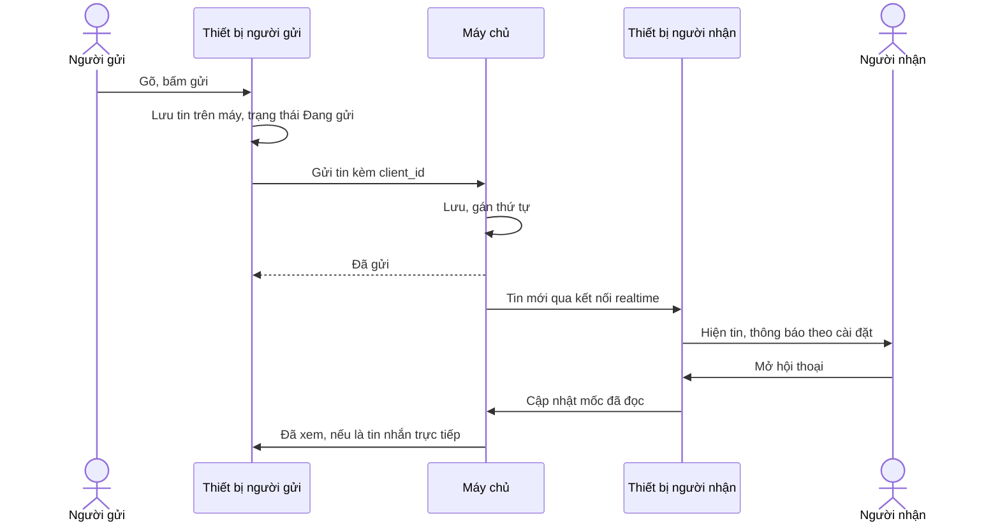

> **Mã:** DE08-TN02-PRD · **Trạng thái:** nháp · **Người viết:** Design (mock) · **SRS:** [SRS.md](SRS.md)

# PRD Nhắn tin realtime (Nhắn tin nội bộ có AI)

> **Bản mock.** Con số đánh dấu `[giả định]` dùng để dựng flow, cần PO xác nhận trước khi dùng.

## 1. Bối cảnh và vấn đề

### 1.1 Bối cảnh

Nhắn tin là hoạt động chính của sản phẩm. Mỗi người dùng thường mở app trên điện thoại và máy tính cùng lúc, đi vào thang máy mất mạng, gửi file từ máy. Tin nhắn phải đến ngay, đúng thứ tự, không mất, không trùng, và mọi thiết bị đều thấy cùng một cuộc trò chuyện.

### 1.2 Vấn đề

| **Vấn đề** | **Hệ quả** |
| --- | --- |
| Tin gửi lúc mất mạng biến mất | Người gửi tưởng đã gửi, người nhận không biết |
| Một chủ đề bị ngắt quãng bởi nhiều chủ đề khác trong kênh | Khó theo dõi, trả lời nhầm ngữ cảnh |
| Đọc trên điện thoại, máy tính vẫn báo chưa đọc | Đọc lại, thông báo thừa |
| Không biết người kia đã đọc chưa | Nhắn lại, gọi điện hỏi |
| Gửi nhầm, sai chính tả | Không sửa được, gây hiểu lầm |
| File lớn tải lâu, lỗi giữa chừng | Gửi lại nhiều lần |

### 1.3 Mục tiêu

- Tin nhắn tới người nhận đang online ≤ 1 giây (p95) `[giả định]`.
- 0 tin bị mất khi gửi lúc mất mạng rồi có mạng lại.
- Trạng thái đã đọc đồng bộ giữa các thiết bị ≤ 3 giây `[giả định]`.

## 2. Người dùng

| **Nhóm** | **Nhu cầu với tính năng này** |
| --- | --- |
| Nhân viên văn phòng | Chat nhanh, thread theo chủ đề, file tài liệu |
| Nhân viên di chuyển nhiều | Gửi được khi mạng yếu, đọc tiếp trên máy tính |
| Quản lý | Biết ai đã đọc thông báo quan trọng |

## 3. Phạm vi

### 3.1 Trong phạm vi (MVP)

- Gửi tin văn bản có định dạng cơ bản (đậm, nghiêng, code, link), emoji, mention.
- Tin nhắn trực tiếp 1-1 và nhóm nhỏ (tối đa 8 người).
- Thread: trả lời một tin, có tuỳ chọn gửi kèm vào kênh.
- File, ảnh: tối đa 100 MB, xem trước ảnh, PDF.
- Sửa, xoá tin của mình; reaction.
- Trạng thái gửi: đang gửi, đã gửi, lỗi; đã xem trong tin nhắn trực tiếp.
- Hàng đợi gửi khi mất mạng; bản nháp theo hội thoại, đồng bộ nhiều thiết bị.
- Mốc đọc tới đâu, nhảy tới tin chưa đọc đầu tiên.

### 3.2 Ngoài phạm vi

- Tin nhắn thoại, video ngắn → phase sau.
- Hẹn giờ gửi tin, nhắc lại tin.
- Mã hoá đầu cuối.
- Chuyển tiếp tin sang hội thoại khác.
- Tìm kiếm tin nhắn theo từ khoá; tìm lại nội dung cũ dùng AI hỏi đáp (TN05).
- Đã xem trong kênh lớn (chỉ có ở tin nhắn trực tiếp).

## 4. Nguyên tắc sản phẩm

### 4.1 Không bao giờ mất tin

Tin nhắn được lưu ngay trên máy trước khi gửi. Mất mạng thì xếp hàng, có mạng thì gửi tiếp theo đúng thứ tự.

### 4.2 Một cuộc trò chuyện, mọi thiết bị

Đọc ở đâu cũng là đã đọc ở mọi nơi. Bản nháp viết dở trên máy tính hiện trên điện thoại.

### 4.3 Chủ đề rõ ràng

Thread giữ trao đổi chi tiết khỏi dòng chính của kênh. Kênh chỉ hiện "{n} trả lời".

### 4.4 Minh bạch về trạng thái

Người gửi luôn biết tin của mình đang gửi, đã gửi, hay lỗi; trong tin nhắn trực tiếp biết đã được xem.

## 5. Quy tắc nghiệp vụ

| **Quy tắc** | **Giá trị** `[giả định]` |
| --- | --- |
| Độ dài tin | Tối đa 4.000 ký tự |
| File | Tối đa 100 MB mỗi file, 10 file mỗi tin |
| Nhóm tin nhắn trực tiếp | Tối đa 8 người |
| Sửa tin | Trong 24 giờ; hiện nhãn "(đã sửa)" |
| Xoá tin | Bất kỳ lúc nào; hiện "Tin nhắn đã bị xoá" nếu có thread |
| Hàng đợi khi mất mạng | Giữ tối đa 7 ngày trên máy |
| Đã xem | Chỉ trong tin nhắn trực tiếp; người dùng tắt được (tắt thì cũng không thấy của người khác) |
| Lưu tin | Không giới hạn thời gian ở MVP |

- Các giá trị trên là **cấu hình theo workspace**, không cố định trong code.

## 6. Luồng trải nghiệm

| **Bước** | **Giai đoạn** | **Trải nghiệm** | **Đầu ra** |
| --- | --- | --- | --- |
| 1 | Soạn | Ô soạn tin có định dạng, mention, emoji, đính kèm; bản nháp tự lưu | Tin sẵn sàng |
| 2 | Gửi | Tin hiện ngay trong hội thoại với trạng thái Đang gửi | Tin trong hàng đợi |
| 3 | Đã gửi | Trạng thái chuyển Đã gửi; người nhận thấy ngay | Tin trên máy chủ |
| 4 | Trả lời | Mở thread, trả lời; kênh hiện số trả lời | Trao đổi theo chủ đề |
| 5 | Đọc | Mở hội thoại, cuộn tới mốc chưa đọc; mọi thiết bị cập nhật | Đã đọc |

## 7. Use Cases, User Stories và Acceptance Criteria

### UC1. Gửi tin nhắn

#### US1.1 Gửi tin văn bản

User Story: Là nhân viên, tôi muốn gửi tin ngay và biết chắc tin đã tới.

AC01: Bấm Gửi (hoặc Enter trên Web) → tin hiện ngay với trạng thái Đang gửi.

AC02: Máy chủ xác nhận → Đã gửi; lỗi → biểu tượng lỗi, nút Thử lại, Xoá.

AC03: Mất mạng → tin xếp hàng, nhãn "Sẽ gửi khi có mạng"; có mạng lại gửi theo đúng thứ tự.

AC04: Không gửi trùng khi gửi lại.

AC05: Định dạng đậm, nghiêng, code, link; mention @người, @kênh (@kênh trong kênh > 20 người hỏi xác nhận).

#### US1.2 Gửi file

User Story: Là thành viên, tôi muốn gửi file, ảnh để chia sẻ tài liệu ngay trong hội thoại.

AC01: Đính kèm từ máy, chụp ảnh, kéo thả (Web); tối đa 10 file, 100 MB mỗi file.

AC02: Thanh tiến trình tải lên; huỷ được; lỗi thì thử lại từ chỗ dừng.

AC03: Ảnh xem trước trong hội thoại; PDF xem trước trang đầu.

### UC2. Thread

AC01: Rê chuột hoặc giữ lâu một tin → Trả lời trong thread.

AC02: Thread mở bên cạnh (Web) hoặc màn riêng (App); kênh hiện "{n} trả lời · {người trả lời}".

AC03: Tuỳ chọn "Gửi kèm vào kênh" khi trả lời.

AC04: Người đã trả lời hoặc được mention trong thread tự theo dõi thread.

### UC3. Sửa, xoá, reaction

AC01: Sửa tin của mình trong 24 giờ; hiện "(đã sửa)".

AC02: Xoá tin của mình, hỏi xác nhận; tin có thread thì hiện "Tin nhắn đã bị xoá", giữ thread.

AC03: Reaction emoji; chạm để xem ai đã thả.

### UC4. Đọc và đồng bộ

#### US4.1 Đọc tiếp đúng chỗ

User Story: Là thành viên, tôi muốn đọc trên một thiết bị thì thiết bị kia cũng biết để không đọc lại và không nhận thông báo thừa.

AC01: Mở hội thoại → cuộn tới tin chưa đọc đầu tiên, có vạch "Tin mới".

AC02: Đọc trên một thiết bị → thiết bị khác bỏ in đậm, bỏ badge ≤ 3 giây.

AC03: Bản nháp đồng bộ giữa thiết bị.

#### US4.2 Đã xem trong tin nhắn trực tiếp

User Story: Là thành viên, tôi muốn biết người kia đã xem tin nhắn trực tiếp chưa để không phải nhắc lại.

AC01: Tin nhắn 1-1 hiện "Đã xem" dưới tin cuối người kia đã đọc.

AC02: Nhóm nhỏ hiện ảnh nhỏ những người đã xem.

AC03: Tắt đã xem trong cài đặt → không gửi trạng thái của mình, không thấy của người khác.

## 8. Chỉ số theo dõi `[giả định]`

| **Chỉ số** | **Định nghĩa** | **Mục tiêu MVP** |
| --- | --- | --- |
| Độ trễ tin | Từ gửi tới hiện trên thiết bị người nhận online | ≤ 1 giây (p95) |
| Tỉ lệ gửi lỗi | Tin lỗi sau 3 lần thử / tin gửi | ≤ 0,1% |
| Tin mất | Tin trong hàng đợi không tới máy chủ | 0 |
| Độ trễ đồng bộ đọc | Từ đọc trên thiết bị A tới thiết bị B cập nhật | ≤ 3 giây (p95) |
| Tỉ lệ dùng thread | Tin trả lời trong thread / tổng tin trong kênh | Theo dõi |
| Tỉ lệ tải file lỗi | Tải lên lỗi / lượt tải lên | ≤ 1% |

## 9. Phụ thuộc và rủi ro

| **Mục** | **Mô tả** | **Hướng xử lý** |
| --- | --- | --- |
| Kết nối realtime | Rớt kết nối khi chuyển mạng | Tự kết nối lại; lấy bù tin theo mốc |
| Thứ tự tin | Nhiều thiết bị gửi cùng lúc | Máy chủ gán thứ tự; client sắp theo thứ tự máy chủ |
| Trùng tin | Gửi lại sau timeout | client_id idempotent |
| File độc hại | Mã độc lan trong công ty | Quét file; chặn định dạng thực thi |
| Pin, dữ liệu di động | Kết nối liên tục tốn pin | Ngắt khi app ở nền, dùng push |

## 10. Câu hỏi mở

> Câu nào đã có giá trị ở mục 5 thì giá trị đó là **tạm chốt** `[giả định]` để dựng flow. Câu hỏi vẫn để mở cho đến khi PO xác nhận.

- Có cho xoá tin của người khác với quyền quản trị không?
- Giới hạn sửa 24 giờ có cần không?
- Đã xem có nên có ở kênh nhỏ (≤ 10 người)?
- Thời gian lưu tin có cần cấu hình theo workspace?
