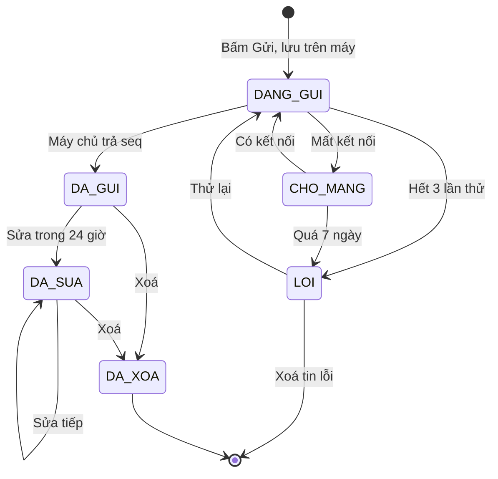
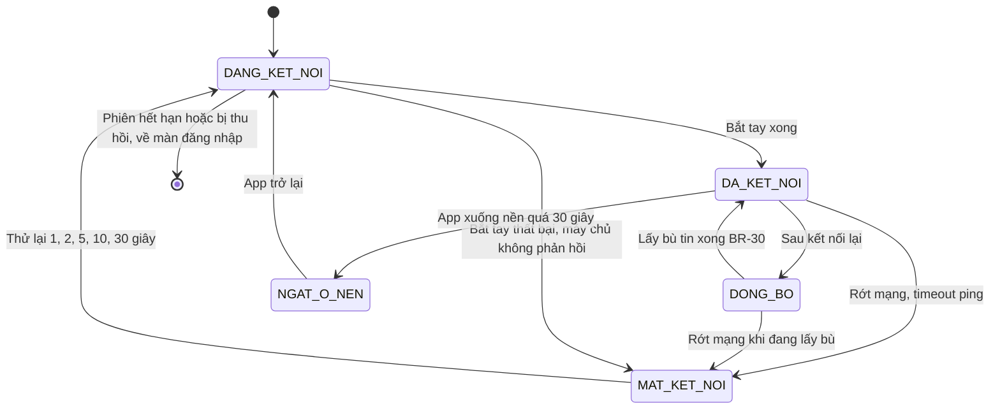
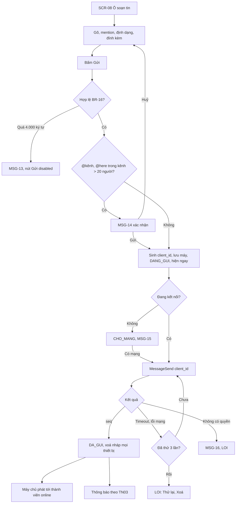
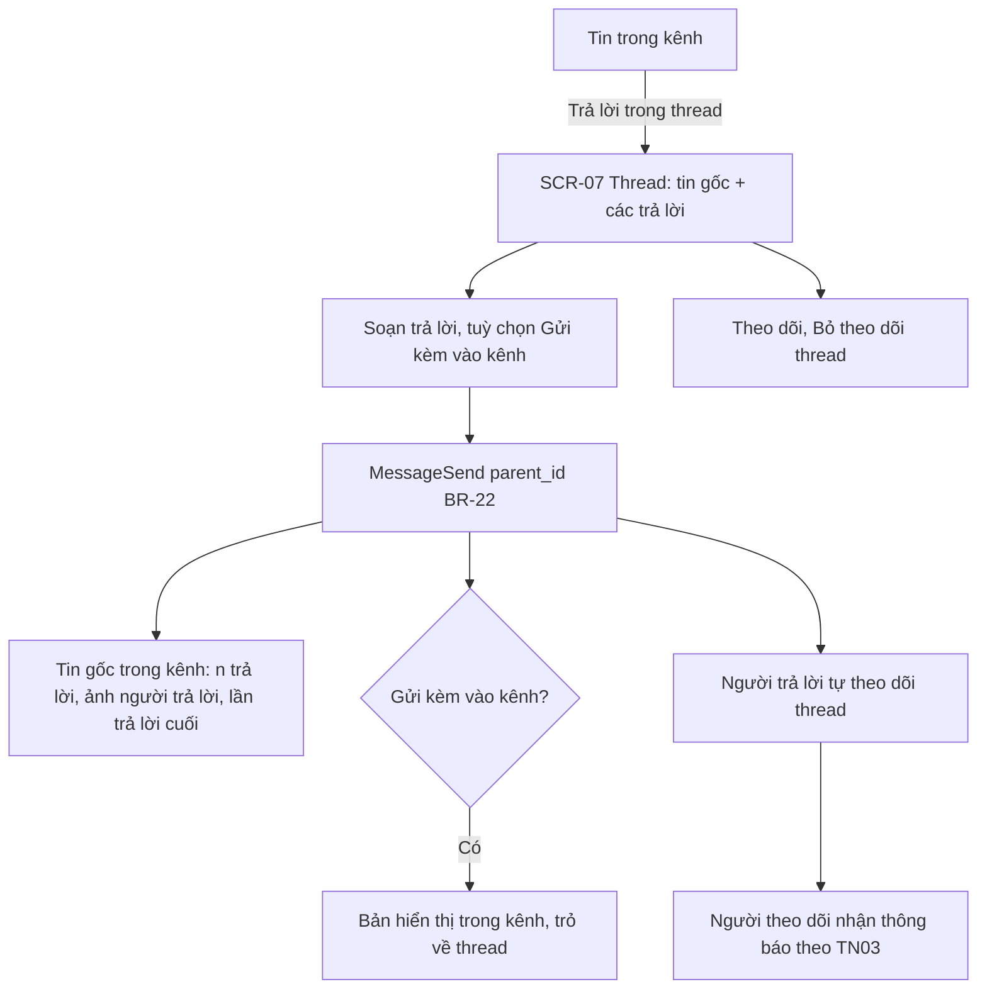
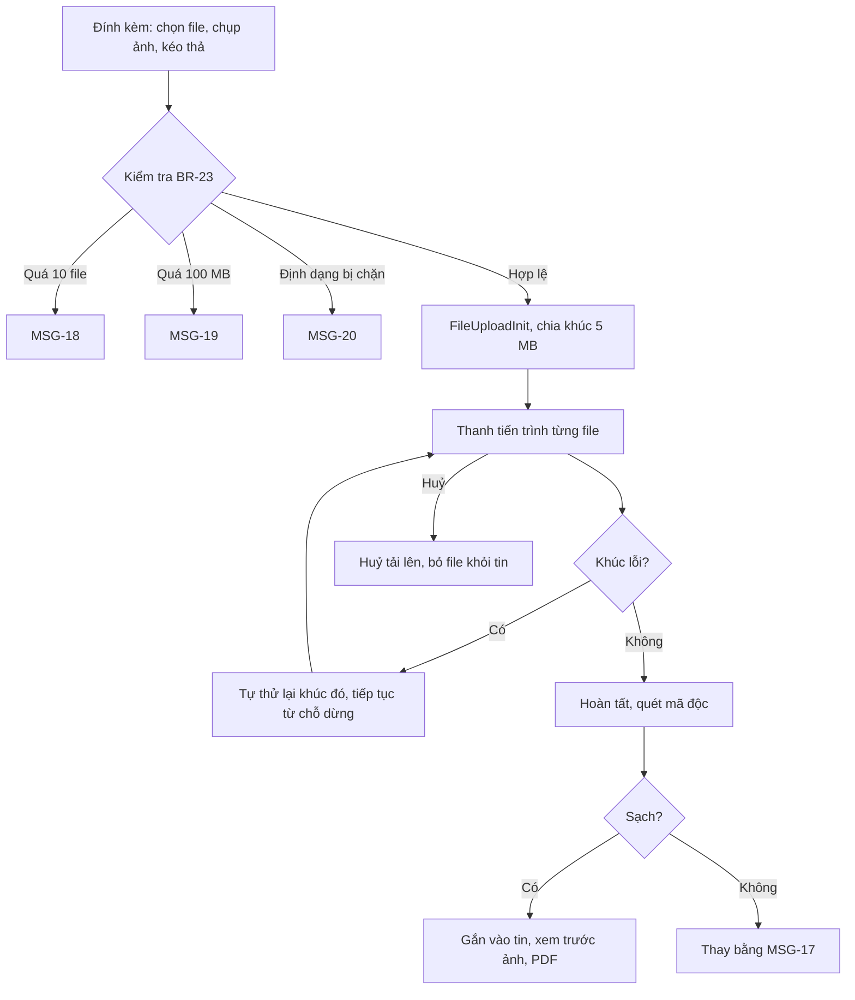
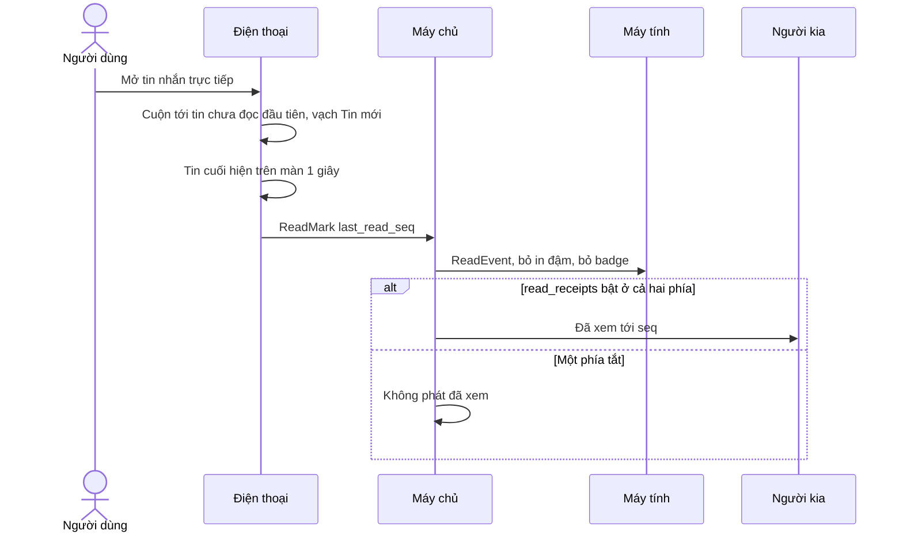
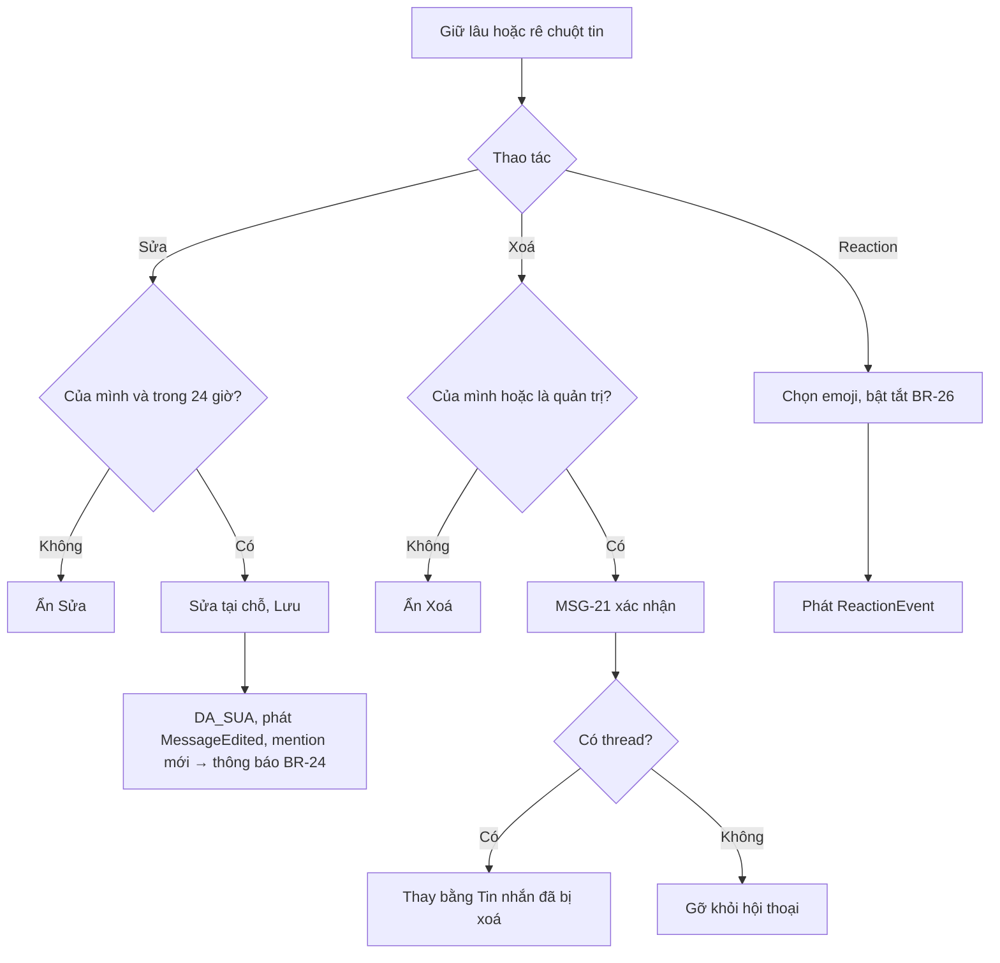

> **Mã:** DE08-TN02-SRS · **Trạng thái:** nháp · **Người viết:** Design (mock) · **PRD:** [PRD.md](PRD.md)

# UC-DE08-02 - Nhắn tin realtime

> **Bản mock.** Giá trị `[giả định]` cần BA xác nhận. Quyền xem hội thoại theo BR-10 ở [SRS TN01](../TN01-workspace-kenh-thanh-vien/SRS.md); thông báo xem [SRS TN03](../TN03-thong-bao-trang-thai/SRS.md).

## 1. Tổng quan

| **Mục** | **Nội dung** |
| --- | --- |
| Mục tiêu | Gửi, nhận tin realtime trong kênh, tin nhắn trực tiếp và thread; file; sửa, xoá, reaction; trạng thái gửi, đã xem; hàng đợi ngoại tuyến; đồng bộ nhiều thiết bị |
| Actor | Thành viên · Khách · App, Web · Cổng realtime · Dịch vụ tin nhắn · Kho file · Dịch vụ quét file |
| Phạm vi | Soạn, gửi, nhận, thread, file, sửa, xoá, reaction, mốc đọc, đã xem, bản nháp, kết nối lại, lấy bù |
| Ngoài phạm vi | Tin thoại, video, hẹn giờ gửi, mã hoá đầu cuối, chuyển tiếp tin |
| Nền tảng | App iOS / Android, Web / Desktop `[giả định]` |
| Figma | `[chưa có]` |

## 2. User Story

| **ID** | **As a** | **I want** | **So that** |
| --- | --- | --- | --- |
| US-07 | Thành viên | Gửi tin và thấy ngay trạng thái | Biết tin đã tới |
| US-08 | Thành viên | Gửi được khi mất mạng | Không mất tin |
| US-09 | Thành viên | Trả lời trong thread | Giữ kênh gọn, đúng ngữ cảnh |
| US-10 | Thành viên | Gửi file, ảnh | Chia sẻ tài liệu |
| US-11 | Thành viên | Đọc trên một máy, máy kia cũng biết | Không đọc lại, không thông báo thừa |
| US-12 | Thành viên | Biết người kia đã xem tin nhắn trực tiếp chưa | Không phải nhắc lại |

## 3. Business Rules

| **Mã** | **Quy tắc** |
| --- | --- |
| BR-15 | **Gửi tin** yêu cầu `can_post`: `can_view` (BR-10) và kênh không `LUU_TRU`; Khách chỉ gửi trong hội thoại được mời |
| BR-16 | **Nội dung**: 1–4.000 ký tự sau khi bỏ khoảng trắng hai đầu, hoặc có ≥ 1 file. Định dạng markdown rút gọn: `**đậm**`, `_nghiêng_`, `` `code` ``, khối code, link tự nhận |
| BR-17 | **client_id**: mỗi tin sinh UUID trên máy khi bấm Gửi; máy chủ idempotent theo (user_id, client_id) |
| BR-18 | **Thứ tự**: máy chủ gán `seq` tăng dần theo hội thoại; client sắp theo `seq`; tin chưa có `seq` (đang gửi) hiện cuối theo thời điểm tạo |
| BR-19 | **Trạng thái gửi** (trên máy người gửi): `DANG_GUI` → `DA_GUI` khi có `seq`; thử tự động 3 lần (1s, 4s, 10s) → `LOI` |
| BR-20 | **Hàng đợi ngoại tuyến**: tin lưu trên máy trước khi gửi; mất kết nối → `CHO_MANG`; có kết nối → gửi tuần tự theo thời điểm tạo; giữ 7 ngày rồi chuyển `LOI` `[giả định]` |
| BR-21 | **Mention**: `@người` (thành viên xem được hội thoại), `@kênh` (mọi thành viên kênh), `@here` (thành viên đang online). `@kênh`, `@here` trong kênh > 20 người → hỏi xác nhận (MSG-14) |
| BR-22 | **Thread**: trả lời gắn `parent_id`; thread chỉ một cấp; "Gửi kèm vào kênh" tạo bản sao hiển thị trong kênh trỏ về thread. Người viết tin gốc, người trả lời, người được mention trong thread tự **theo dõi** thread |
| BR-23 | **File**: tối đa 10 file mỗi tin, 100 MB mỗi file; chặn `.exe`, `.bat`, `.sh`, `.msi`, `.apk`, `.dmg` `[giả định]`; tải lên chia khúc 5 MB, tiếp tục được khi lỗi; quét mã độc; file bị đánh dấu nguy hiểm → thay bằng MSG-17 |
| BR-24 | **Sửa**: chỉ người gửi, trong 24 giờ; giữ lịch sử phiên bản ở máy chủ; hiện "(đã sửa)". Mention mới thêm khi sửa → gửi thông báo cho người mới được mention |
| BR-25 | **Xoá**: người gửi bất kỳ lúc nào; quản trị xoá được tin của người khác `[giả định]`. Tin có thread → thay bằng "Tin nhắn đã bị xoá", giữ thread; không có thread → gỡ hẳn. File đính kèm bị xoá theo |
| BR-26 | **Reaction**: tối đa 20 emoji khác nhau mỗi tin; mỗi người một lần mỗi emoji |
| BR-27 | **Mốc đọc** `last_read_seq` theo (user, hội thoại): cập nhật khi tin cuối cùng hiện trên màn ≥ 1 giây và app đang ở trước; đồng bộ tới mọi thiết bị của user. Thread có mốc đọc riêng |
| BR-28 | **Đã xem**: chỉ tin nhắn trực tiếp; hiện người khác đã xem tới tin nào theo `last_read_seq` của họ; user tắt `read_receipts` → không phát mốc của mình cho người khác và không thấy mốc của người khác |
| BR-29 | **Bản nháp** theo hội thoại và thread, lưu máy ngay và đồng bộ máy chủ sau 2 giây ngừng gõ; gửi tin xoá nháp ở mọi thiết bị |
| BR-30 | **Kết nối lại**: khi kết nối realtime mở lại, client gửi `seq` cuối đã biết của từng hội thoại đang mở; máy chủ trả tin thiếu (tối đa 500 mỗi hội thoại, nhiều hơn thì báo "Có tin cũ hơn" để tải dần) |

## 4. Trạng thái

### 4.1 Tin nhắn trên máy người gửi

| **Trạng thái** | **Hiển thị cho người gửi** | **Người nhận** |
| --- | --- | --- |
| `DANG_GUI` | Tin mờ, biểu tượng đồng hồ | Chưa thấy |
| `CHO_MANG` | Tin mờ, "Sẽ gửi khi có mạng" | Chưa thấy |
| `LOI` | Biểu tượng lỗi đỏ, "Chưa gửi được · Thử lại · Xoá" | Chưa thấy |
| `DA_GUI` | Bình thường; tin nhắn trực tiếp có "Đã gửi" / "Đã xem" | Thấy |
| `DA_SUA` | Nhãn "(đã sửa)" | Nhãn "(đã sửa)" |
| `DA_XOA` | "Tin nhắn đã bị xoá" (khi có thread) hoặc biến mất | Như người gửi |

### 4.2 Kết nối realtime

## 5. Use Case

### UC-06 Gửi tin nhắn

| **Mục** | **Nội dung** |
| --- | --- |
| Tiền điều kiện | User có `can_post` trong hội thoại (BR-15) |
| Hậu điều kiện thành công | Tin có `seq`, mọi thành viên online nhận realtime, offline nhận khi kết nối lại |
| Hậu điều kiện thất bại | Tin ở `LOI` trên máy người gửi, có Thử lại |

**Luồng chính**

| **Bước** | **Actor** | **Mô tả** |
| --- | --- | --- |
| 1 | Thành viên | Soạn tin ở **SCR-08**, bấm Gửi |
| 2 | Client | Kiểm tra BR-16; sinh `client_id` (BR-17); lưu máy; hiện tin `DANG_GUI` |
| 3 | Client | Gửi \[MessageSend\] qua kết nối realtime (dự phòng HTTP) |
| 4 | Máy chủ | Kiểm tra BR-15; lưu; gán `seq` (BR-18); trả xác nhận |
| 5 | Client | Tin `DA_GUI`; xoá bản nháp (BR-29) |
| 6 | Máy chủ | Phát \[MessageEvent\] cho thành viên hội thoại đang kết nối; giao TN03 xử lý thông báo |

**Luồng thay thế**

| **Mã** | **Điều kiện** | **Xử lý** |
| --- | --- | --- |
| A1 | Mất kết nối | `CHO_MANG` (BR-20); gửi tuần tự khi có mạng |
| A2 | Gửi lại tin `LOI` | Dùng lại `client_id`; máy chủ không tạo trùng |
| A3 | Có file | UC-08 chạy trước; tin chỉ gửi khi mọi file tải xong |
| A4 | Kênh vừa bị lưu trữ, bị xoá khỏi kênh | MSG-16; tin `LOI` không có nút Thử lại |

### UC-07 Thread

| **Mục** | **Nội dung** |
| --- | --- |
| Tiền điều kiện | Người dùng xem được hội thoại chứa tin gốc (BR-10); kênh không `LUU_TRU` |
| Hậu điều kiện | Trả lời gắn vào thread; tin gốc cập nhật số trả lời và lần trả lời cuối |

**Luồng chính**

| **Bước** | **Actor** | **Mô tả** |
| --- | --- | --- |
| 1 | Thành viên | Ở một tin trong kênh, chọn Trả lời trong thread |
| 2 | Hệ thống | Mở **SCR-07**: tin gốc và các trả lời |
| 3 | Thành viên | Soạn trả lời, bấm Gửi |
| 4 | Hệ thống | Gọi \[MessageSend\] kèm `parent_id` (BR-22) |
| 5 | Hệ thống | Tin gốc trong kênh cập nhật số trả lời, ảnh người trả lời, lần trả lời cuối |
| 6 | Hệ thống | Người trả lời tự theo dõi thread; người theo dõi nhận thông báo (SRS TN03) |

**Luồng thay thế**

| **Mã** | **Điều kiện** | **Xử lý** |
| --- | --- | --- |
| A1 | Chọn "Gửi kèm vào kênh" | Trả lời hiện thêm trong kênh, trỏ về thread |
| A2 | Bấm Theo dõi hoặc Bỏ theo dõi | Bật, tắt thông báo của thread đó |

**Luồng lỗi**

| **Mã** | **Điều kiện** | **Xử lý** |
| --- | --- | --- |
| E1 | Gửi thất bại | Tin `LOI` với MSG-23: Thử lại hoặc Xoá |
| E2 | Mất quyền trong hội thoại | MSG-16 |

### UC-08 Gửi file

| **Mục** | **Nội dung** |
| --- | --- |
| Tiền điều kiện | `can_post` |
| Hậu điều kiện | File tải lên, quét sạch, gắn vào tin |

**Luồng chính**

| **Bước** | **Actor** | **Mô tả** |
| --- | --- | --- |
| 1 | Thành viên | Đính kèm: chọn file, chụp ảnh, hoặc kéo thả (Web) |
| 2 | Hệ thống | Kiểm tra theo BR-23 |
| 3 | Hệ thống | Gọi \[FileUploadInit\], tải lên theo khúc 5 MB, hiện thanh tiến trình từng file |
| 4 | Hệ thống | Tải xong → quét mã độc |
| 5 | Hệ thống | File sạch → gắn vào tin; xem trước ảnh, PDF |

**Luồng thay thế**

| **Mã** | **Điều kiện** | **Xử lý** |
| --- | --- | --- |
| A1 | Một khúc tải lỗi | Tự thử lại khúc đó, tiếp tục từ chỗ dừng |
| A2 | Bấm Huỷ khi đang tải | Huỷ tải lên, bỏ file khỏi tin |

**Luồng lỗi**

| **Mã** | **Điều kiện** | **Xử lý** |
| --- | --- | --- |
| E1 | Quá 10 file | MSG-18 |
| E2 | File quá 100 MB | MSG-19 |
| E3 | Định dạng bị chặn | MSG-20 |
| E4 | File không an toàn | Thay file bằng MSG-17 |

### UC-09 Đọc, đồng bộ và đã xem

| **Mục** | **Nội dung** |
| --- | --- |
| Tiền điều kiện | `can_view` |
| Hậu điều kiện | `last_read_seq` cập nhật trên mọi thiết bị; đã xem phát cho người khác (tin nhắn trực tiếp) |

**Luồng chính**

| **Bước** | **Actor** | **Mô tả** |
| --- | --- | --- |
| 1 | Thành viên | Mở hội thoại |
| 2 | Hệ thống | Cuộn tới tin chưa đọc đầu tiên, hiện vạch "Tin mới" |
| 3 | Hệ thống | Tin cuối hiện trên màn đủ 1 giây → gọi \[ReadMark\] với `last_read_seq` |
| 4 | Hệ thống | Phát `ReadEvent` tới thiết bị khác của người dùng: bỏ in đậm, bỏ badge |
| 5 | Hệ thống | Tin nhắn trực tiếp, hai phía cùng bật đã xem → người kia thấy "Đã xem" |

**Luồng thay thế**

| **Mã** | **Điều kiện** | **Xử lý** |
| --- | --- | --- |
| A1 | Một trong hai phía tắt đã xem | Không phát trạng thái đã xem |
| A2 | Nhóm nhỏ | Hiện ảnh nhỏ của những người đã xem |

**Luồng lỗi**

| **Mã** | **Điều kiện** | **Xử lý** |
| --- | --- | --- |
| E1 | Mất mạng khi đánh dấu đã đọc | Lưu trên máy, gửi \[ReadMark\] khi kết nối lại |

### UC-10 Sửa, xoá, reaction

| **Mục** | **Nội dung** |
| --- | --- |
| Tiền điều kiện | Tin `DA_GUI` hoặc `DA_SUA`; sửa, xoá chỉ với tin của mình, sửa trong 24 giờ |
| Hậu điều kiện | Tin `DA_SUA`, `DA_XOA`, hoặc reaction được cập nhật trên mọi thiết bị |

**Luồng chính**

| **Bước** | **Actor** | **Mô tả** |
| --- | --- | --- |
| 1 | Thành viên | Giữ lâu hoặc rê chuột vào tin của mình, chọn Sửa |
| 2 | Thành viên | Sửa tại chỗ, bấm Lưu |
| 3 | Hệ thống | Gọi \[MessageEdit\]: tin `DA_SUA`, phát sự kiện `MessageEdited` tới mọi thiết bị |
| 4 | Hệ thống | Mention mới thêm khi sửa → gửi thông báo (BR-24) |

**Luồng thay thế**

| **Mã** | **Điều kiện** | **Xử lý** |
| --- | --- | --- |
| A1 | Chọn Xoá | MSG-21 hỏi xác nhận → tin có thread thay bằng "Tin nhắn đã bị xoá", tin không có thread gỡ khỏi hội thoại |
| A2 | Chọn Reaction | Chọn emoji để bật hoặc tắt (BR-26); phát sự kiện `ReactionEvent` tới mọi thiết bị |

**Luồng lỗi**

| **Mã** | **Điều kiện** | **Xử lý** |
| --- | --- | --- |
| E1 | Không phải tin của mình, hoặc quá 24 giờ | Ẩn Sửa |
| E2 | Không phải tin của mình và không phải quản trị | Ẩn Xoá |

## 6. Điểm vào

| **Điểm vào** | **Web** | **App** | **Dẫn tới** | **Ghi chú** |
| --- | --- | --- | --- | --- |
| Chạm kênh, người trên **SCR-02** | ✓ | ✓ | **SCR-06** | Cuộn tới tin chưa đọc |
| "Nhắn tin mới" | ✓ | ✓ | Chọn người → **SCR-06** tin nhắn trực tiếp | Tối đa 8 người |
| "{n} trả lời" dưới tin | ✓ | ✓ | **SCR-07** |  |
| Thông báo đẩy | ✓ | ✓ | **SCR-06** hoặc **SCR-07**, nhảy tới đúng tin | SRS TN03 |
| Nguồn trích dẫn của AI | ✓ | ✓ | **SCR-06** nhảy tới đúng tin | SRS TN04, TN05 |

## 7. Mô tả màn hình

### SCR-06 Hội thoại

| **#** | **Thành phần** | **Loại** | **Hành vi** |
| --- | --- | --- | --- |
| 1 | Header | Header | Tên kênh (khoá nếu riêng tư) hoặc tên người; số thành viên; nút Tóm tắt AI (TN04); thông tin (**SCR-04**) |
| 2 | Banner | Banner | Lưu trữ (MSG-10), mất kết nối (MSG-22), có tin cũ hơn chưa tải |
| 3 | Danh sách tin | List ảo hoá | Gom theo người và khoảng 5 phút; ngăn cách theo ngày; vạch "Tin mới" |
| 4 | Tin | Item | Ảnh, tên, giờ, nội dung có định dạng, file, reaction, "{n} trả lời", "(đã sửa)", trạng thái gửi |
| 5 | Nhảy xuống tin mới | FAB | Hiện khi đang cuộn lên và có tin mới, kèm số |
| 6 | Đã xem | Text phụ | Chỉ tin nhắn trực tiếp (BR-28) |
| 7 | Ô soạn tin | **SCR-08** | |

### SCR-07 Thread

| **#** | **Thành phần** | **Loại** | **Hành vi** |
| --- | --- | --- | --- |
| 1 | Tin gốc | Card | Như tin trong kênh |
| 2 | Các trả lời | List | Theo `seq` |
| 3 | Theo dõi | Toggle | BR-22 |
| 4 | Ô soạn | **SCR-08** | Thêm checkbox "Gửi kèm vào #{kênh}" |

### SCR-08 Ô soạn tin

| **#** | **Thành phần** | **Loại** | **Hành vi** |
| --- | --- | --- | --- |
| 1 | Nội dung | Text nhiều dòng | Định dạng BR-16; bộ đếm khi > 3.500 ký tự |
| 2 | Gợi ý mention | Popup | Gõ "@" → thành viên xem được hội thoại, @kênh, @here |
| 3 | Emoji | Button | Bảng emoji |
| 4 | Đính kèm | Button | UC-08; danh sách file đang tải với tiến trình, huỷ |
| 5 | Gửi | Button | Disabled khi rỗng; Enter gửi, Shift+Enter xuống dòng (Web) |
| 6 | Bản nháp | Trạng thái | Tự lưu, đồng bộ (BR-29); nhãn "Nháp" ở thanh bên |

## 8. API

| **API** | **Request chính** | **Response chính** | **Timeout / retry** `[giả định]` |
| --- | --- | --- | --- |
| \[RealtimeConnect\] | token, device_id, last_seq theo hội thoại | Tin bù, trạng thái | Ping 25 giây; kết nối lại theo 4.2 |
| \[MessageSend\] | conversation_id, client_id, text, file_ids, parent_id, also_send_to_channel | message_id, seq, created_at | 5s / BR-19 |
| \[MessageEvent\] (máy chủ → client) | type (NEW, EDITED, DELETED, REACTION), message | – | Qua kết nối realtime |
| \[MessageList\] | conversation_id, before_seq hoặc after_seq, limit | Tin | 3s / 2 lần |
| \[ThreadGet\] | parent_id | Tin gốc, trả lời, followed | 3s / 2 lần |
| \[MessageEdit\] | message_id, text | message | 5s / 2 lần |
| \[MessageDelete\] | message_id | – | 5s / 2 lần |
| \[ReactionToggle\] | message_id, emoji | reactions | 3s / 2 lần |
| \[FileUploadInit\], \[FileUploadChunk\], \[FileUploadComplete\] | file meta, chunk | file_id, scan_status | 30s mỗi khúc / 3 lần |
| \[ReadMark\] | conversation_id hoặc thread_id, last_read_seq | – | 3s / gộp và gửi lại |
| \[DraftSave\] | conversation_id, thread_id, text | – | 3s / ghi đè lần sau |

**Map lỗi → thông báo**

| **Nhóm lỗi** | **Message** |
| --- | --- |
| Tin vượt 4.000 ký tự | MSG-13 |
| Không còn quyền trong hội thoại | MSG-16 |
| File bị chặn vì không an toàn | MSG-17 |
| Vượt số file, dung lượng, loại file | MSG-18, MSG-19, MSG-20 |
| Mất kết nối | MSG-22; tin chờ gửi hiện MSG-15 |
| Gửi thất bại sau 3 lần thử | MSG-23 |

## 9. Danh sách thông báo

| **ID** | **Nơi hiện** | **Nội dung (VI)** |
| --- | --- | --- |
| MSG-13 | Inline | Tin nhắn tối đa 4.000 ký tự |
| MSG-14 | Popup | Gửi thông báo tới {n} người trong #{kênh}? \[Huỷ\] \[Gửi\] |
| MSG-15 | Nhãn dưới tin | Sẽ gửi khi có mạng |
| MSG-16 | Nhãn dưới tin | Không gửi được vì bạn không còn quyền trong hội thoại này |
| MSG-17 | Thay file | File này đã bị chặn vì có thể không an toàn |
| MSG-18 | Toast | Mỗi tin tối đa 10 file |
| MSG-19 | Toast | File "{tên}" vượt quá 100 MB |
| MSG-20 | Toast | Không hỗ trợ gửi file dạng {đuôi file} |
| MSG-21 | Popup | Xoá tin nhắn này? Không thể hoàn tác. \[Huỷ\] \[Xoá\] |
| MSG-22 | Banner | Đang kết nối lại… Tin nhắn của bạn sẽ được gửi khi có mạng |
| MSG-23 | Nhãn dưới tin | Chưa gửi được · Thử lại · Xoá |
| MSG-24 | Banner | Có tin cũ hơn. \[Tải thêm\] |

Bản EN: `[chờ bổ sung]`.

## 10. Yêu cầu phi chức năng

| **Mục** | **Yêu cầu** `[giả định]` |
| --- | --- |
| Hiệu năng | Gửi tới nhận ≤ 1 giây (p95); mở hội thoại ≤ 500 ms từ cache; cuộn mượt 60 khung hình/giây với 10.000 tin |
| Tin cậy | Không mất, không trùng tin (BR-17, BR-20); thứ tự theo `seq`; lấy bù sau kết nối lại |
| Bảo mật | Mã hoá khi truyền và khi lưu; mọi API kiểm tra BR-10, BR-15; link file có hạn và gắn quyền |
| Offline | Đọc tin đã cache, soạn và xếp hàng khi mất mạng |
| Log / audit | Mỗi lần sửa, xoá tin: người thực hiện, thời điểm; lỗi gửi và mỗi lần kết nối lại kèm mã lỗi; không ghi nội dung tin vào log |
| Tracking | Độ trễ gửi, lỗi gửi, hàng đợi ngoại tuyến, thread, file (dung lượng, lỗi), sửa, xoá, reaction, độ trễ đồng bộ đọc |
| Accessibility | Trạng thái gửi có nhãn đọc màn hình; tin mới được thông báo bằng vùng live; định dạng code có tương phản đủ ở chế độ tối |
