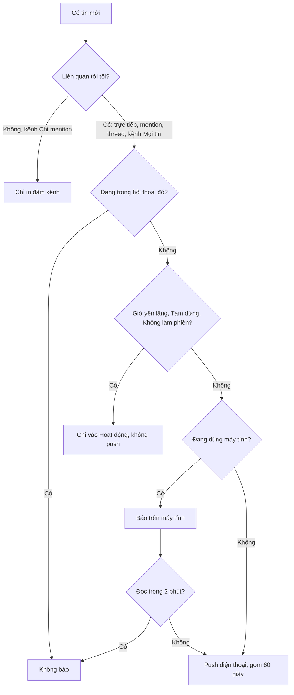

> **Mã:** DE08-TN03-PRD · **Trạng thái:** nháp · **Người viết:** Design (mock) · **SRS:** [SRS.md](SRS.md)

# PRD Thông báo và trạng thái online (Nhắn tin nội bộ có AI)

> **Bản mock.** Con số đánh dấu `[giả định]` dùng để dựng flow, cần PO xác nhận trước khi dùng.

## 1. Bối cảnh và vấn đề

### 1.1 Bối cảnh

Tin nhắn ([TN02](../TN02-nhan-tin-realtime/PRD.md)) chỉ có ích khi đến đúng người, đúng lúc. Nhắn tin công việc dễ trở thành nguồn gây xao nhãng lớn nhất trong ngày: mỗi tin là một tiếng "ting". Tính năng này quyết định **khi nào** làm phiền người dùng, và cho người khác biết đồng nghiệp đang có mặt hay không.

### 1.2 Vấn đề

| **Vấn đề** | **Hệ quả** |
| --- | --- |
| Mọi tin trong mọi kênh đều thông báo | Người dùng tắt hết thông báo, rồi bỏ lỡ việc gấp |
| Thông báo cả trên điện thoại khi đang ngồi máy tính | Rung liên tục, phiền |
| Bị nhắn lúc nửa đêm, cuối tuần | Căng thẳng, mất cân bằng công việc |
| Không biết đồng nghiệp đang họp hay nghỉ phép | Nhắn rồi chờ, tưởng bị phớt lờ |
| Không có chỗ xem lại các lần mình được nhắc | Bỏ sót mention |

### 1.3 Mục tiêu

- Tỉ lệ người dùng tắt toàn bộ thông báo ≤ 10% `[giả định]`.
- ≥ 90% mention được người được nhắc xem trong 4 giờ làm việc `[giả định]`.
- Không gửi push tới điện thoại khi người dùng đang hoạt động trên máy tính.

## 2. Người dùng

| **Nhóm** | **Nhu cầu với tính năng này** |
| --- | --- |
| Nhân viên tập trung làm việc | Chỉ bị báo khi được nhắc tên hoặc tin nhắn trực tiếp |
| Quản lý | Theo dõi kênh quan trọng sát hơn kênh khác |
| Người làm ca, khác múi giờ | Giờ yên lặng theo lịch của mình |
| Đồng nghiệp | Biết người kia đang online, họp, nghỉ phép |

## 3. Phạm vi

### 3.1 Trong phạm vi (MVP)

- Mặc định thông báo cho: tin nhắn trực tiếp, mention, trả lời trong thread đang theo dõi.
- Cài đặt theo kênh: Mọi tin, Chỉ mention (mặc định), Tắt.
- Giờ yên lặng theo lịch (mặc định 19:00–08:00 và cuối tuần) và Tạm dừng thông báo (30 phút, 1 giờ, 2 giờ, tới mai).
- Định tuyến: đang hoạt động trên máy tính thì không push điện thoại; sau 2 phút chưa đọc mới push.
- Gom thông báo: nhiều tin trong cùng hội thoại trong 1 phút thành một thông báo.
- Trang Hoạt động: mention, trả lời, reaction vào tin của mình.
- Trạng thái online: Đang hoạt động, Vắng mặt (tự động), Không làm phiền.
- Trạng thái tuỳ chỉnh: biểu tượng, chữ, thời hạn ("Đang họp tới 15:00", "Nghỉ phép tới 20/11").

### 3.2 Ngoài phạm vi

- Thông báo qua email tóm tắt → phase sau.
- Từ khoá theo dõi tuỳ chỉnh.
- Đồng bộ trạng thái từ lịch (Google, Outlook).
- Ưu tiên thông báo bằng AI.

## 4. Nguyên tắc sản phẩm

### 4.1 Im lặng là mặc định, gọi tên mới báo

Chỉ báo những gì cần người dùng: tin trực tiếp, được nhắc tên, thread đang tham gia.

### 4.2 Báo một nơi, đúng nơi

Đang ngồi máy tính thì báo trên máy tính. Điện thoại chỉ rung khi người dùng thực sự rời máy.

### 4.3 Tôn trọng giờ nghỉ

Giờ yên lặng chặn push. Người gửi biết người nhận đang ngoài giờ trước khi gửi.

### 4.4 Trạng thái giúp đặt kỳ vọng

Người gửi thấy "Đang họp", "Nghỉ phép" ngay ở ô soạn tin, để không chờ trả lời ngay.

## 5. Quy tắc nghiệp vụ

| **Quy tắc** | **Giá trị** `[giả định]` |
| --- | --- |
| Mức thông báo kênh | Mọi tin · Chỉ mention (mặc định) · Tắt |
| Tin nhắn trực tiếp | Luôn thông báo trừ khi người dùng tắt cuộc trò chuyện đó |
| Giờ yên lặng mặc định | 19:00–08:00 thứ Hai – thứ Sáu, cả ngày thứ Bảy, Chủ Nhật; theo múi giờ người dùng |
| Định tuyến | Có hoạt động trên máy tính trong 2 phút gần nhất → chỉ báo trên máy tính; chưa đọc sau 2 phút → push điện thoại |
| Gom thông báo | Cùng hội thoại trong 60 giây → gộp |
| Vắng mặt tự động | Không hoạt động 10 phút trên mọi thiết bị |
| Trạng thái tuỳ chỉnh | Chữ ≤ 100 ký tự; hết hạn: 30 phút, 1 giờ, hôm nay, tuần này, ngày tuỳ chọn, không hết hạn |
| Vượt giờ yên lặng | Người gửi tin nhắn trực tiếp được chọn "Vẫn thông báo" cho việc gấp (tối đa 3 lần mỗi ngày mỗi người gửi) |

- Các giá trị trên là **cấu hình theo workspace và người dùng**, không cố định trong code.

## 6. Luồng trải nghiệm

| **Bước** | **Giai đoạn** | **Trải nghiệm** | **Đầu ra** |
| --- | --- | --- | --- |
| 1 | Thiết lập | Lần đầu: gợi ý giờ yên lặng, mức thông báo mặc định | Cài đặt cá nhân |
| 2 | Theo kênh | Chuông trong thông tin kênh: Mọi tin, Chỉ mention, Tắt | Mức theo kênh |
| 3 | Nhận | Thông báo trên đúng thiết bị, gộp khi nhiều tin | Biết có việc |
| 4 | Xem lại | Trang Hoạt động: mention, trả lời, reaction | Không bỏ sót |
| 5 | Trạng thái | Đặt "Đang họp tới 15:00"; người khác thấy ở ô soạn | Đặt kỳ vọng |

## 7. Use Cases, User Stories và Acceptance Criteria

### UC1. Cài đặt thông báo

#### US1.1 Chọn mức thông báo

User Story: Là nhân viên, tôi muốn chỉ được báo khi có việc liên quan tới tôi để tập trung làm việc.

AC01: Mặc định: tin nhắn trực tiếp, mention, thread đang theo dõi.

AC02: Mỗi kênh chọn Mọi tin, Chỉ mention, Tắt; kênh Tắt vẫn báo khi bị mention trực tiếp tên `[giả định]`.

AC03: Tắt một cuộc trò chuyện trực tiếp được.

#### US1.2 Giờ yên lặng và tạm dừng

User Story: Là thành viên, tôi muốn đặt giờ yên lặng và tạm dừng thông báo để không bị làm phiền ngoài giờ.

AC01: Đặt giờ yên lặng theo ngày trong tuần; mặc định theo bảng mục 5.

AC02: Tạm dừng nhanh 30 phút, 1 giờ, 2 giờ, tới sáng mai.

AC03: Trong giờ yên lặng, thông báo chỉ vào trang Hoạt động, không push.

AC04: Hết giờ yên lặng → không dồn hàng loạt push; trang Hoạt động hiện số mục mới.

### UC2. Nhận thông báo

AC01: Đang hoạt động trên máy tính → chỉ báo trên máy tính.

AC02: Chưa đọc sau 2 phút → push điện thoại.

AC03: Nhiều tin cùng hội thoại trong 60 giây → một thông báo "{n} tin mới từ {hội thoại}".

AC04: Đọc ở bất kỳ thiết bị nào → gỡ thông báo đã hiện ở thiết bị khác.

AC05: Chạm thông báo → mở đúng tin hoặc thread.

AC06: Nội dung push không hiện tin của kênh riêng tư trên màn khoá nếu người dùng bật "Ẩn nội dung" `[giả định]`.

### UC3. Trang Hoạt động

AC01: Liệt kê mention, trả lời trong thread theo dõi, reaction vào tin của mình; mới nhất trước.

AC02: Lọc: Tất cả, Mention, Trả lời, Reaction.

AC03: Mục chưa xem in đậm; đánh dấu đã xem tất cả.

### UC4. Trạng thái

#### US4.1 Online, vắng mặt, không làm phiền

User Story: Là thành viên, tôi muốn thấy ai đang hoạt động, vắng mặt hay không làm phiền để biết khi nào nên nhắn.

AC01: Chấm trạng thái cạnh tên: Đang hoạt động, Vắng mặt, Không làm phiền; chỉ hiện với người cùng workspace.

AC02: Vắng mặt tự động sau 10 phút không hoạt động trên mọi thiết bị.

AC03: Không làm phiền = tạm dừng thông báo + hiện trạng thái cho người khác.

#### US4.2 Trạng thái tuỳ chỉnh

User Story: Là thành viên, tôi muốn đặt trạng thái như "Đang họp tới 15:00" để người khác biết khi nào tôi trả lời.

AC01: Chọn mẫu (Đang họp, Đang di chuyển, Nghỉ ốm, Nghỉ phép, Làm việc từ xa) hoặc tự gõ; chọn thời hạn.

AC02: Trạng thái hiện cạnh tên ở hội thoại, hồ sơ và ngay trên ô soạn tin nhắn trực tiếp.

AC03: Hết hạn tự xoá.

#### US4.3 Người gửi biết người nhận ngoài giờ

User Story: Là thành viên, tôi muốn biết người nhận đang ngoài giờ trước khi nhắn để không làm phiền khi việc không gấp.

AC01: Nhắn tin trực tiếp cho người đang trong giờ yên lặng → ô soạn hiện "{tên} đang ngoài giờ làm việc tới {giờ} và sẽ không nhận thông báo đẩy cho tin này"; tin vẫn vào mục Hoạt động của họ.

AC02: Người gửi chọn "Vẫn thông báo" cho việc gấp, tối đa 3 lần mỗi ngày.

## 8. Chỉ số theo dõi `[giả định]`

| **Chỉ số** | **Định nghĩa** | **Mục tiêu MVP** |
| --- | --- | --- |
| Tỉ lệ tắt toàn bộ | Người dùng tắt thông báo ở cấp hệ điều hành hoặc app / người dùng hoạt động | ≤ 10% |
| Push mỗi người mỗi ngày | Trung vị số push | Theo dõi; mục tiêu giảm theo thời gian |
| Tỉ lệ mention được xem | Mention được xem trong 4 giờ làm việc / mention | ≥ 90% |
| Push thừa | Push điện thoại cho tin đã đọc trên máy tính | 0 |
| Tỉ lệ dùng trạng thái tuỳ chỉnh | Người dùng đặt ≥ 1 trạng thái mỗi tuần / người dùng hoạt động | Theo dõi |
| Vượt giờ yên lặng | Lượt "Vẫn thông báo" / tin gửi trong giờ yên lặng của người nhận | Theo dõi |

## 9. Phụ thuộc và rủi ro

| **Mục** | **Mô tả** | **Hướng xử lý** |
| --- | --- | --- |
| Dịch vụ push của hệ điều hành | Chậm, bị gom, bị chặn | Trang Hoạt động là nguồn đáng tin; badge đồng bộ |
| Phát hiện "đang dùng máy tính" sai | Không ai báo, bỏ lỡ | Hai phút chưa đọc thì luôn push |
| Lạm dụng "Vẫn thông báo" | Phá giờ yên lặng | Giới hạn 3 lần mỗi ngày; người nhận tắt được tính năng này |
| Lộ trạng thái | Quản lý theo dõi giờ online của nhân viên | Không lưu lịch sử online; chỉ hiện trạng thái hiện tại |

## 10. Câu hỏi mở

> Mọi câu hỏi dưới đây đã được PO chốt ngày 13/11/2026; quyết định ghi sau mỗi câu và đã cập nhật vào SRS.

- Kênh "Tắt" có báo khi bị mention trực tiếp tên không? → **Đã chốt:** Có báo mention trực tiếp tên, không báo @kênh (SRS BR-32).
- Có cho người dùng ẩn trạng thái online không? → **Đã chốt:** Có (SRS BR-40).
- Giờ yên lặng có do quản trị đặt chung cho workspace? → **Đã chốt:** Không. Mỗi người tự đặt (SRS BR-35).
- Thông báo @kênh có vượt qua mức "Chỉ mention" không? → **Đã chốt:** Có. Mức Chỉ mention vẫn báo @kênh; chỉ mức Tắt chặn @kênh (SRS BR-32).
