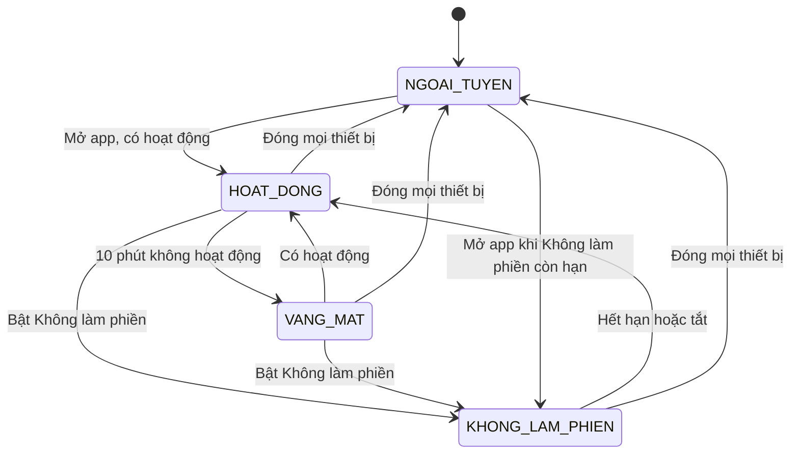
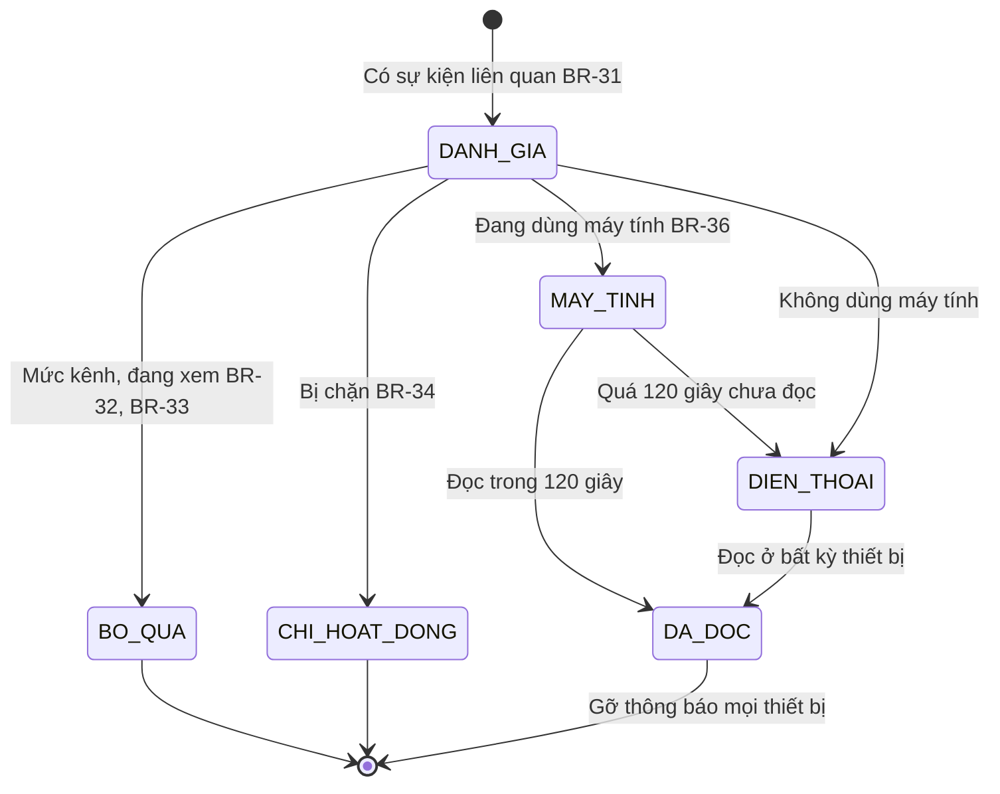
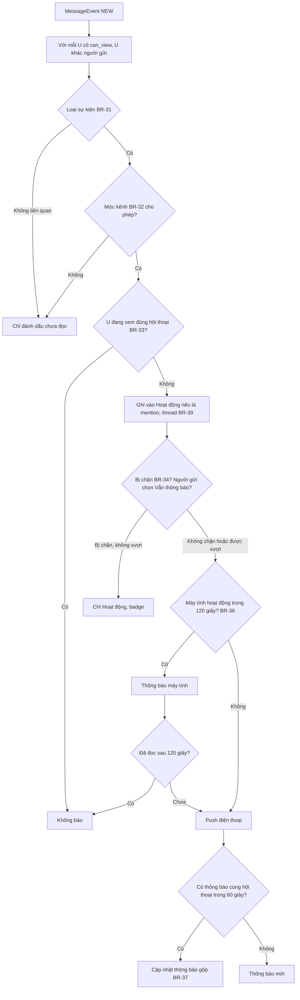
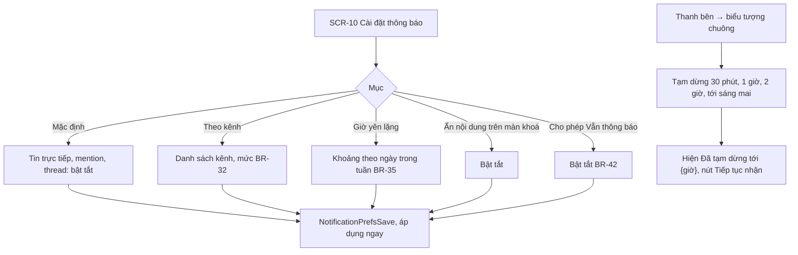
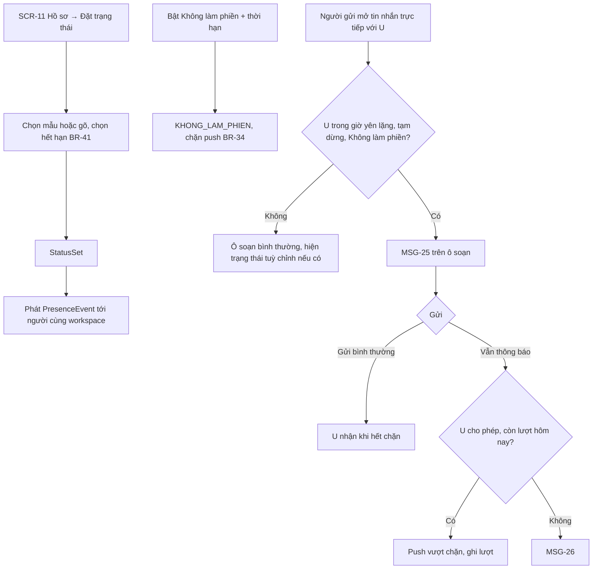
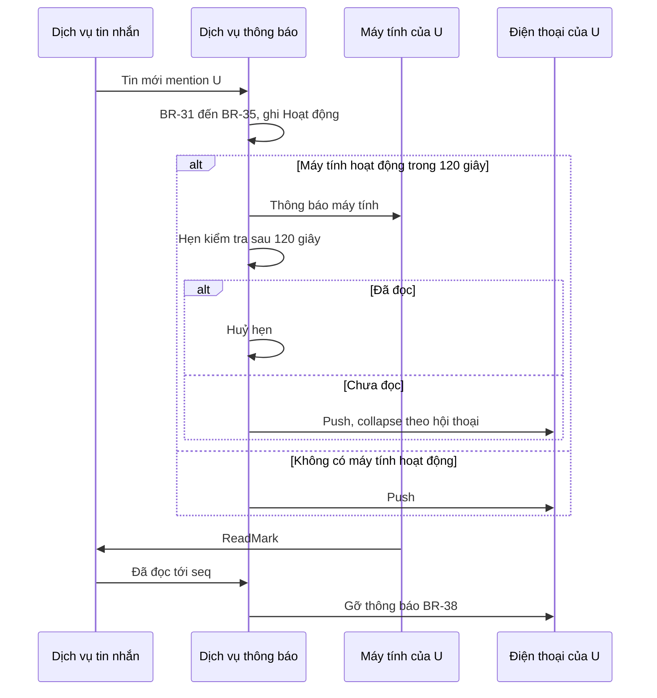

> **Mã:** DE08-TN03-SRS · **Trạng thái:** nháp · **Người viết:** Design (mock) · **PRD:** [PRD.md](PRD.md)

# UC-DE08-03 - Thông báo và trạng thái online

> **Bản mock.** Giá trị `[giả định]` cần BA xác nhận. Sự kiện tin nhắn đến từ [SRS TN02](../TN02-nhan-tin-realtime/SRS.md); quyền xem theo BR-10 ở [SRS TN01](../TN01-workspace-kenh-thanh-vien/SRS.md).

## 1. Tổng quan

| **Mục** | **Nội dung** |
| --- | --- |
| Mục tiêu | Quyết định ai được báo, khi nào, trên thiết bị nào; trang Hoạt động; trạng thái online và tuỳ chỉnh |
| Actor | Thành viên · App, Web · Dịch vụ thông báo · Dịch vụ trạng thái · APNs, FCM |
| Phạm vi | Mức thông báo, giờ yên lặng, tạm dừng, định tuyến thiết bị, gom, gỡ thông báo, Hoạt động, trạng thái online, tuỳ chỉnh, cảnh báo ngoài giờ cho người gửi |
| Ngoài phạm vi | Email tóm tắt, từ khoá theo dõi, đồng bộ lịch, ưu tiên bằng AI |
| Nền tảng | App iOS / Android, Web / Desktop `[giả định]` |
| Figma | `[chưa có]` |

## 2. User Story

| **ID** | **As a** | **I want** | **So that** |
| --- | --- | --- | --- |
| US-13 | Thành viên | Chỉ được báo khi liên quan tới mình | Tập trung làm việc |
| US-14 | Thành viên | Đặt mức thông báo theo kênh | Theo dõi kênh quan trọng sát hơn |
| US-15 | Thành viên | Giờ yên lặng, tạm dừng | Không bị làm phiền ngoài giờ |
| US-16 | Thành viên | Không bị rung điện thoại khi đang dùng máy tính | Bớt phiền |
| US-17 | Thành viên | Xem lại mọi mention, trả lời | Không bỏ sót |
| US-18 | Thành viên | Đặt trạng thái "Đang họp tới 15:00" | Người khác biết khi nào tôi trả lời |

## 3. Business Rules

| **Mã** | **Quy tắc** |
| --- | --- |
| BR-31 | **Sự kiện liên quan** tới user U với tin M trong hội thoại C (U ≠ người gửi, `can_view(U, C)`): `TRUC_TIEP` (C là tin nhắn trực tiếp có U), `MENTION` (M mention U), `MENTION_KENH` (@kênh, hoặc @here khi U online), `THREAD` (M trả lời thread U theo dõi), `MOI_TIN` (C đặt "Mọi tin") |
| BR-32 | **Mức thông báo kênh**: `MOI_TIN`, `CHI_MENTION` (mặc định), `TAT`. `TAT` vẫn báo `MENTION` trực tiếp tên `[giả định]`, không báo `MENTION_KENH`. Tin nhắn trực tiếp mặc định bật, tắt được từng cuộc trò chuyện |
| BR-33 | **Không báo** nếu U đang mở đúng hội thoại hoặc thread đó trên thiết bị đang ở trước và tin đã hiện trên màn |
| BR-34 | **Chặn push** khi: trong giờ yên lặng, đang Tạm dừng, trạng thái Không làm phiền. Sự kiện vẫn vào trang Hoạt động và badge |
| BR-35 | **Giờ yên lặng**: danh sách khoảng theo ngày trong tuần, theo múi giờ U; mặc định 19:00–08:00 T2–T6, cả ngày T7, CN `[giả định]`. Tạm dừng: 30 phút, 1 giờ, 2 giờ, tới 08:00 hôm sau |
| BR-36 | **Định tuyến thiết bị**: U có hoạt động (gõ, cuộn, chạm) trên máy tính trong 120 giây gần nhất → chỉ thông báo máy tính; sau 120 giây sự kiện chưa được đọc → push điện thoại. Không có máy tính đang hoạt động → push ngay |
| BR-37 | **Gom thông báo**: sự kiện cùng hội thoại (hoặc thread) cho cùng U trong 60 giây gộp thành 1 thông báo "{n} tin mới"; cập nhật thông báo đang hiện thay vì tạo mới |
| BR-38 | **Gỡ thông báo**: khi `last_read_seq` (BR-27) vượt qua tin của thông báo, gửi lệnh gỡ thông báo tới mọi thiết bị của U; badge = số hội thoại có mention hoặc tin trực tiếp chưa đọc |
| BR-39 | **Hoạt động**: lưu sự kiện `MENTION`, `MENTION_KENH`, `THREAD`, reaction vào tin của U; giữ 90 ngày; mỗi mục có trạng thái đã xem |
| BR-40 | **Trạng thái online**: `HOAT_DONG` khi có thiết bị kết nối và có hoạt động trong 10 phút; `VANG_MAT` khi không; `KHONG_LAM_PHIEN` do U bật (kèm thời hạn). Không lưu lịch sử thay đổi trạng thái online |
| BR-41 | **Trạng thái tuỳ chỉnh**: biểu tượng + chữ ≤ 100 ký tự + hết hạn (30 phút, 1 giờ, hôm nay, tuần này, ngày giờ, không hết hạn); mẫu có sẵn; hết hạn tự xoá |
| BR-42 | **Ngoài giờ cho người gửi**: soạn tin trực tiếp cho U đang trong giờ yên lặng, tạm dừng hoặc Không làm phiền → ô soạn hiện MSG-25. Người gửi chọn "Vẫn thông báo" → push vượt chặn; tối đa 3 lần mỗi ngày mỗi cặp người gửi – U; U tắt được quyền này trong cài đặt |

## 4. Trạng thái

### 4.1 Trạng thái online

| **Trạng thái** | **Hiển thị cho người khác** |
| --- | --- |
| `HOAT_DONG` | Chấm xanh, nhãn "Đang hoạt động" |
| `VANG_MAT`, `NGOAI_TUYEN` | Chấm rỗng, nhãn "Vắng mặt" (không phân biệt để bảo vệ riêng tư) |
| `KHONG_LAM_PHIEN` | Biểu tượng trăng, nhãn "Không làm phiền tới {giờ}" |

### 4.2 Vòng đời một thông báo

## 5. Use Case

### UC-11 Đánh giá và gửi thông báo

| **Mục** | **Nội dung** |
| --- | --- |
| Tiền điều kiện | Tin mới `DA_GUI` (TN02) |
| Hậu điều kiện | Mỗi người liên quan nhận đúng một thông báo phù hợp, hoặc chỉ một mục trong Hoạt động |

**Luồng chính**

| **Bước** | **Actor** | **Mô tả** |
| --- | --- | --- |
| 1 | Dịch vụ thông báo | Nhận \[MessageEvent\]; xác định người liên quan (BR-31) |
| 2 | Dịch vụ thông báo | Áp mức kênh (BR-32), đang xem (BR-33) |
| 3 | Dịch vụ thông báo | Ghi Hoạt động (BR-39); kiểm tra chặn (BR-34, BR-42) |
| 4 | Dịch vụ thông báo | Định tuyến thiết bị (BR-36), gom (BR-37); gửi |
| 5 | Thiết bị | Hiện thông báo; chạm mở đúng tin |

### UC-12 Cài đặt thông báo, giờ yên lặng, tạm dừng

| **Mục** | **Nội dung** |
| --- | --- |
| Tiền điều kiện | Thành viên đã đăng nhập |
| Hậu điều kiện | Cài đặt lưu theo tài khoản, áp dụng cho mọi thiết bị |

**Luồng chính**

| **Bước** | **Actor** | **Mô tả** |
| --- | --- | --- |
| 1 | Thành viên | Mở **SCR-10** Cài đặt thông báo |
| 2 | Thành viên | Bật, tắt thông báo mặc định cho tin trực tiếp, mention, thread |
| 3 | Hệ thống | Gọi \[NotificationPrefsGet\] và lưu thay đổi; áp dụng ngay trên mọi thiết bị |

**Luồng thay thế**

| **Mã** | **Điều kiện** | **Xử lý** |
| --- | --- | --- |
| A1 | Đặt mức theo kênh | Chọn kênh và mức thông báo (BR-32) |
| A2 | Đặt giờ yên lặng | Chọn khoảng giờ theo ngày trong tuần (BR-35) |
| A3 | Ẩn nội dung trên màn khoá, cho phép "Vẫn thông báo" | Bật, tắt từng mục (BR-42) |
| A4 | Tạm dừng nhanh từ biểu tượng chuông | Chọn 30 phút, 1 giờ, 2 giờ, tới sáng mai → hiện MSG-30 kèm nút Tiếp tục nhận |

**Luồng lỗi**

| **Mã** | **Điều kiện** | **Xử lý** |
| --- | --- | --- |
| E1 | Lưu thất bại | Báo lỗi, giữ giá trị cũ, cho thử lại |

### UC-13 Trang Hoạt động

| **Mục** | **Nội dung** |
| --- | --- |
| Tiền điều kiện | Thành viên đã đăng nhập |
| Hậu điều kiện | Mục đã xem được đánh dấu; badge Hoạt động giảm tương ứng |

**Luồng chính**

| **Bước** | **Actor** | **Mô tả** |
| --- | --- | --- |
| 1 | Thành viên | Thanh bên → Hoạt động |
| 2 | App | **SCR-09**: mục mới nhất trước; lọc Tất cả, Mention, Trả lời, Reaction |
| 3 | Thành viên | Chạm mục → mở đúng tin, thread; mục đánh dấu đã xem |
| 4 | Thành viên | "Đánh dấu đã xem tất cả" |

### UC-14 Đặt trạng thái và cảnh báo ngoài giờ

| **Mục** | **Nội dung** |
| --- | --- |
| Tiền điều kiện | Thành viên đã đăng nhập |
| Hậu điều kiện | Trạng thái hiện với người cùng workspace tới khi hết hạn; người gửi tin thấy cảnh báo ngoài giờ |

**Luồng chính**

| **Bước** | **Actor** | **Mô tả** |
| --- | --- | --- |
| 1 | Thành viên | **SCR-11** Hồ sơ → Đặt trạng thái |
| 2 | Thành viên | Chọn mẫu hoặc tự gõ, chọn thời điểm hết hạn (BR-41) |
| 3 | Hệ thống | Gọi \[StatusSet\]; phát \[PresenceEvent\] tới người cùng workspace |
| 4 | Người gửi | Mở tin nhắn trực tiếp với thành viên đó |
| 5 | Hệ thống | Ô soạn hiện trạng thái tuỳ chỉnh (MSG-32) |

**Luồng thay thế**

| **Mã** | **Điều kiện** | **Xử lý** |
| --- | --- | --- |
| A1 | Bật Không làm phiền kèm thời hạn | Trạng thái `KHONG_LAM_PHIEN`, chặn push (BR-34) |
| A2 | Người nhận đang trong giờ yên lặng, tạm dừng hoặc Không làm phiền | Ô soạn hiện MSG-25; gửi bình thường thì người nhận thấy khi hết chặn |
| A3 | Người gửi chọn "Vẫn thông báo" | Người nhận cho phép và còn lượt trong ngày → push vượt chặn, ghi lượt |

**Luồng lỗi**

| **Mã** | **Điều kiện** | **Xử lý** |
| --- | --- | --- |
| E1 | Hết lượt "Vẫn thông báo", hoặc người nhận không cho phép | MSG-26; tin vẫn gửi nhưng không push |

## 6. Điểm vào

| **Điểm vào** | **Web** | **App** | **Dẫn tới** | **Ghi chú** |
| --- | --- | --- | --- | --- |
| Thanh bên → Hoạt động | ✓ | ✓ | UC-13, **SCR-09** | Badge số mục chưa xem |
| Thanh bên → chuông | ✓ | ✓ | Tạm dừng nhanh |  |
| Hồ sơ → Cài đặt thông báo | ✓ | ✓ | UC-12, **SCR-10** |  |
| Thông tin kênh → Thông báo | ✓ | ✓ | Mức kênh |  |
| Ảnh đại diện của mình | ✓ | ✓ | **SCR-11**, UC-14 |  |
| Lần đầu dùng app | ✓ | ✓ | Gợi ý giờ yên lặng |  |

## 7. Mô tả màn hình

### SCR-09 Hoạt động

| **#** | **Thành phần** | **Loại** | **Hành vi** |
| --- | --- | --- | --- |
| 1 | Lọc | Tabs | Tất cả · Mention · Trả lời · Reaction |
| 2 | Mục | List | Ảnh người, "{tên} nhắc đến bạn trong #{kênh}", đoạn trích, thời gian; in đậm khi chưa xem |
| 3 | Đánh dấu đã xem tất cả | Button text | |
| 4 | Màn trống | Empty state | "Bạn đã xem hết. Mention và trả lời sẽ hiện ở đây" |

### SCR-10 Cài đặt thông báo

| **#** | **Thành phần** | **Loại** | **Hành vi** |
| --- | --- | --- | --- |
| 1 | Mặc định | Toggles | Tin trực tiếp, Mention, Trả lời thread |
| 2 | Theo kênh | List + select | BR-32; kênh đặt khác mặc định nổi lên đầu |
| 3 | Giờ yên lặng | Bảng theo ngày | BR-35; xem trước "Hôm nay bạn sẽ không nhận push từ {giờ}" |
| 4 | Ẩn nội dung trên màn khoá | Toggle | |
| 5 | Cho phép đồng nghiệp vượt giờ yên lặng khi gấp | Toggle | BR-42 |
| 6 | Đã xem | Toggle | BR-28 (TN02) |

### SCR-11 Hồ sơ, trạng thái

| **#** | **Thành phần** | **Loại** | **Hành vi** |
| --- | --- | --- | --- |
| 1 | Trạng thái online | Text | Theo 4.1 |
| 2 | Trạng thái tuỳ chỉnh | Picker | Mẫu: Đang họp, Đang di chuyển, Nghỉ ốm, Nghỉ phép, Làm việc từ xa; ô tự gõ; hết hạn |
| 3 | Không làm phiền | Toggle + thời hạn | |
| 4 | Giờ địa phương | Text | "Giờ địa phương {hh:mm}" cho người khác thấy khi khác múi giờ |

## 8. API

| **API** | **Request chính** | **Response chính** | **Timeout / retry** `[giả định]` |
| --- | --- | --- | --- |
| \[NotificationPrefsGet\], \[NotificationPrefsSave\] | Mặc định, theo kênh, giờ yên lặng, tuỳ chọn | prefs | 3s / 2 lần |
| \[SnoozeSet\] | duration | snoozed_until | 3s / 2 lần |
| \[ActivityList\] | filter, cursor | Mục Hoạt động | 3s / 1 lần |
| \[ActivityMarkSeen\] | item_ids hoặc all | – | 3s / 2 lần |
| \[DeviceActivityPing\] | device_id, type (DESKTOP, MOBILE) | – | Mỗi 30 giây khi có hoạt động |
| \[PushSend\] (nội bộ → APNs, FCM) | device_token, payload, collapse_key | – | 5s / 3 lần |
| \[NotificationDismiss\] (nội bộ → thiết bị) | conversation_id, up_to_seq | – | Qua realtime hoặc push im lặng |
| \[StatusSet\] | emoji, text, expires_at, dnd_until | status | 3s / 2 lần |
| \[PresenceEvent\] (máy chủ → client) | user_id, presence, status | – | Realtime, gộp 5 giây |
| \[RecipientAvailability\] | user_id | quiet, until, can_override, overrides_left | 2s / 1 lần |

**Map lỗi → thông báo**

| **Nhóm lỗi** | **Message** |
| --- | --- |
| Hết lượt "Vẫn thông báo" trong ngày | MSG-26 |
| Lưu cài đặt thông báo, trạng thái thất bại | Thông báo lỗi chung của app (ngoài bộ MSG của SRS này), cho thử lại; giữ giá trị cũ |
| Không gửi được push tới thiết bị | Không báo người dùng; mục vẫn có ở trang Hoạt động |

## 9. Danh sách thông báo

| **ID** | **Nơi hiện** | **Nội dung (VI)** |
| --- | --- | --- |
| MSG-25 | Trên ô soạn | {Tên} đang {ngoài giờ làm việc / tạm dừng thông báo / không làm phiền}, sẽ nhận thông báo lúc {giờ}. \[Vẫn thông báo\] |
| MSG-26 | Toast | Bạn đã dùng hết lượt "Vẫn thông báo" cho {tên} hôm nay, hoặc {tên} đã tắt tính năng này |
| MSG-27 | Push | {Người gửi} trong #{kênh}: {đoạn trích} |
| MSG-28 | Push gộp | {n} tin mới trong #{kênh} |
| MSG-29 | Push (ẩn nội dung) | Bạn có tin mới trong {workspace} |
| MSG-30 | Banner thanh bên | Đã tạm dừng thông báo tới {giờ}. \[Tiếp tục nhận\] |
| MSG-31 | Gợi ý lần đầu | Bạn muốn yên lặng sau giờ làm? Chúng tôi đề xuất 19:00–08:00 và cuối tuần. \[Dùng đề xuất\] \[Tự chọn\] |
| MSG-32 | Banner hội thoại | {Tên}: {trạng thái tuỳ chỉnh} |

Bản EN: `[chờ bổ sung]`.

## 10. Yêu cầu phi chức năng

| **Mục** | **Yêu cầu** `[giả định]` |
| --- | --- |
| Hiệu năng | Đánh giá và gửi thông báo ≤ 2 giây sau khi tin `DA_GUI` (không tính chờ 120 giây của BR-36) |
| Tin cậy | Không gửi trùng thông báo cho một sự kiện; gỡ thông báo đã đọc ≤ 5 giây |
| Riêng tư | Không lưu lịch sử trạng thái online; người ngoài workspace không thấy trạng thái; ẩn nội dung trên màn khoá |
| Thời gian | Giờ yên lặng theo múi giờ người nhận, tự cập nhật khi thiết bị đổi múi giờ |
| Log / audit | Mỗi thông báo: lý do gửi hoặc không gửi (mức kênh, giờ yên lặng, đang dùng máy tính), kênh gửi, kết quả; mỗi lần dùng "Vẫn thông báo" |
| Tracking | Push gửi, mở, gộp; push bị chặn bởi giờ yên lặng; định tuyến máy tính; vượt giờ yên lặng; đặt trạng thái; tắt thông báo kênh |
| Accessibility | Trạng thái online có nhãn chữ, không chỉ màu chấm; thông báo có nội dung đọc được bằng trình đọc màn hình |
