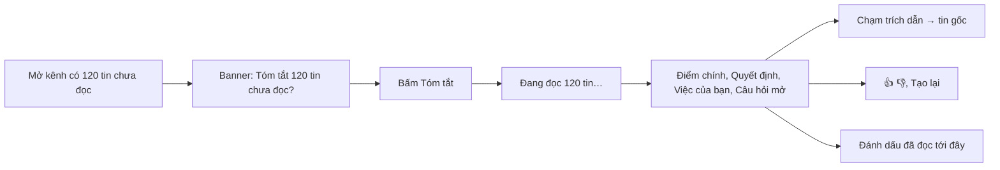

> **Mã:** DE08-TN04-PRD · **Trạng thái:** nháp · **Người viết:** Design (mock) · **SRS:** [SRS.md](SRS.md)

# PRD AI tóm tắt kênh và thread (Nhắn tin nội bộ có AI)

> **Bản mock.** Con số đánh dấu `[giả định]` dùng để dựng flow, cần PO xác nhận trước khi dùng.

## 1. Bối cảnh và vấn đề

### 1.1 Bối cảnh

Sau một buổi họp dài hay vài ngày nghỉ phép, người dùng quay lại với hàng trăm tin chưa đọc trong nhiều kênh ([TN02](../TN02-nhan-tin-realtime/PRD.md)). Đọc hết thì mất cả buổi; bỏ qua thì sợ sót việc. Trợ lý AI tóm tắt giúp người dùng nắm nhanh: có gì quan trọng, quyết định gì đã được đưa ra, việc nào giao cho mình. Tóm tắt chỉ có giá trị khi người dùng tin được và kiểm tra lại được.

### 1.2 Vấn đề

| **Vấn đề** | **Hệ quả** |
| --- | --- |
| Hàng trăm tin chưa đọc sau khi vắng mặt | Mất nhiều thời gian đọc, hoặc bỏ sót việc |
| Thread dài 80 trả lời, vào sau không hiểu | Hỏi lại, làm chậm cả nhóm |
| Tóm tắt AI không rõ dựa trên tin nào | Không tin, không dám hành động theo |
| AI có thể bịa hoặc hiểu sai | Quyết định sai |
| Lo AI đọc kênh mình không được xem | Rủi ro bảo mật, mất niềm tin |

### 1.3 Mục tiêu

- Tóm tắt kênh có ≥ 50 tin chưa đọc được tạo trong ≤ 10 giây `[giả định]`.
- ≥ 80% đánh giá tóm tắt là hữu ích (👍) trong số lượt đánh giá `[giả định]`.
- 100% ý trong tóm tắt có trích dẫn về tin gốc.
- 0 trường hợp tóm tắt chứa nội dung người dùng không có quyền xem.

## 2. Người dùng

| **Nhóm** | **Nhu cầu với tính năng này** |
| --- | --- |
| Nhân viên quay lại sau họp, nghỉ phép | Biết có gì quan trọng, việc gì cho mình |
| Quản lý theo dõi nhiều kênh | Nắm quyết định, vướng mắc mà không đọc hết |
| Người tham gia thread muộn | Hiểu bối cảnh trước khi trả lời |

## 3. Phạm vi

### 3.1 Trong phạm vi (MVP)

- Tóm tắt tin chưa đọc của một kênh hoặc tin nhắn trực tiếp nhóm.
- Tóm tắt một thread.
- Tóm tắt theo khoảng thời gian: hôm nay, 7 ngày qua.
- Cấu trúc tóm tắt: Điểm chính, Quyết định, Việc cần làm (kèm người được giao), Câu hỏi còn mở.
- Mỗi ý có trích dẫn, chạm để nhảy tới tin gốc.
- Bảng "Tóm tắt cho bạn": danh sách kênh có nhiều tin chưa đọc, tóm tắt theo yêu cầu.
- Phản hồi 👍 👎 kèm lý do; tạo lại.
- Tôn trọng quyền xem (TN01 BR-10) và kênh loại trừ khỏi AI (TN01 BR-14).

### 3.2 Ngoài phạm vi

- Tóm tắt tự động gửi theo lịch (bản tin buổi sáng) → phase sau.
- Tóm tắt nội dung file đính kèm.
- Tóm tắt cuộc gọi.
- AI tự đăng tóm tắt vào kênh cho người khác.

## 4. Nguyên tắc sản phẩm

### 4.1 Không thấy nhiều hơn bạn

AI chỉ đọc những tin người yêu cầu đang có quyền xem, trừ kênh bị loại trừ. Tóm tắt là riêng của người yêu cầu, không ai khác thấy.

### 4.2 Mỗi ý có nguồn

Mỗi điểm chính, quyết định, việc cần làm đều trích dẫn tin gốc. Không có nguồn thì không đưa vào.

### 4.3 Nói rõ đây là AI

Tóm tắt luôn có nhãn "Do AI tạo, có thể sai sót" và thời điểm tạo, phạm vi tin đã đọc.

### 4.4 Ngắn, có cấu trúc, ưu tiên điều liên quan tới bạn

Việc giao cho người đọc và mention người đọc được đưa lên đầu.

## 5. Quy tắc nghiệp vụ

| **Quy tắc** | **Giá trị** `[giả định]` |
| --- | --- |
| Tóm tắt kênh | Khi có ≥ 10 tin chưa đọc (ít hơn thì gợi ý đọc trực tiếp) |
| Phạm vi tối đa | 500 tin gần nhất trong phạm vi yêu cầu; nhiều hơn thì nói rõ phần đã tóm tắt |
| Độ dài | Tối đa 5 điểm chính, mỗi mục ≤ 2 câu |
| Trích dẫn | Mỗi mục ≥ 1 tin gốc; mục không có trích dẫn hợp lệ bị loại |
| Bộ nhớ đệm | Cùng người, cùng phạm vi, không có tin mới → dùng lại tóm tắt trong 30 phút |
| Giới hạn | 50 lượt tóm tắt mỗi người mỗi ngày |
| Lưu trữ | Không dùng tin nhắn để huấn luyện mô hình; tóm tắt lưu 7 ngày cho người yêu cầu |
| Kênh loại trừ | Không có nút tóm tắt, không xuất hiện trong bảng tóm tắt |

- Các giá trị trên là **cấu hình theo workspace**, không cố định trong code.

## 6. Luồng trải nghiệm

| **Bước** | **Giai đoạn** | **Trải nghiệm** | **Đầu ra** |
| --- | --- | --- | --- |
| 1 | Gợi ý | Mở kênh có ≥ 10 tin chưa đọc → banner mời tóm tắt; hoặc nút ✨ ở header | Yêu cầu tóm tắt |
| 2 | Đang tạo | Trạng thái "Đang đọc {n} tin", hiện dần từng phần | Chờ ngắn |
| 3 | Đọc tóm tắt | Các phần có cấu trúc; việc của bạn nổi bật | Nắm nội dung |
| 4 | Kiểm tra | Chạm số trích dẫn → nhảy tới tin gốc, tô sáng | Tin tưởng |
| 5 | Phản hồi | 👍 👎 + lý do; Tạo lại | Cải thiện chất lượng |
| 6 | Kết thúc | "Đánh dấu đã đọc" hoặc đọc tiếp tin gốc | Theo kịp kênh |

## 7. Use Cases, User Stories và Acceptance Criteria

### UC1. Tóm tắt kênh

#### US1.1 Tóm tắt tin chưa đọc

User Story: Là nhân viên vừa họp xong, tôi muốn biết nhanh kênh dự án có gì quan trọng mà không đọc hết.

AC01: Kênh có ≥ 10 tin chưa đọc → banner "Tóm tắt {n} tin chưa đọc"; nút ✨ luôn có ở header.

AC02: Tóm tắt gồm: Điểm chính, Quyết định, Việc cần làm (người được giao, hạn nếu có), Câu hỏi còn mở; phần trống thì ẩn.

AC03: Việc được giao cho người đọc hoặc mention người đọc hiện ở đầu, có nhãn "Liên quan tới bạn".

AC04: Mỗi mục có số trích dẫn; chạm mở tin gốc trong hội thoại, tô sáng.

AC05: Hiện "Tóm tắt {n} tin từ {thời điểm} đến {thời điểm} · Do AI tạo, có thể sai sót".

AC06: Có "Đánh dấu đã đọc" sau khi xem tóm tắt; chỉ đánh dấu tới tin cuối cùng đã được tóm tắt, tin đến sau vẫn là chưa đọc. Tóm tắt bị cắt ở 500 tin thì hỏi xác nhận trước.

#### US1.2 Tóm tắt theo khoảng thời gian

User Story: Là thành viên, tôi muốn tóm tắt theo khoảng thời gian mình chọn để theo kịp đúng phần đã bỏ lỡ.

AC01: Chọn: Tin chưa đọc (mặc định), Hôm nay, 7 ngày qua.

AC02: Vượt 500 tin → tóm tắt 500 tin gần nhất, báo rõ.

### UC2. Tóm tắt thread

AC01: Thread ≥ 10 trả lời có nút "Tóm tắt thread".

AC02: Tóm tắt hiện trên đầu thread, chỉ người yêu cầu thấy.

AC03: Cấu trúc và trích dẫn như tóm tắt kênh.

### UC3. Bảng tóm tắt cho bạn

AC01: Thanh bên → "Tóm tắt" liệt kê kênh có nhiều tin chưa đọc, sắp theo số mention của bạn rồi số tin.

AC02: Chạm một kênh để tạo tóm tắt; có thể tạo nhiều kênh lần lượt.

### UC4. Tin cậy và an toàn

AC01: Kênh bị loại trừ hoặc AI tắt → không có nút tóm tắt; kênh loại trừ hiện lý do khi rê chuột.

AC02: Khách không thấy tính năng.

AC03: Tóm tắt không bao giờ chứa tin từ kênh người dùng không xem được, kể cả trích dẫn.

AC04: Không đủ thông tin (tin chỉ là emoji, chào hỏi) → nói rõ "Không có nội dung đáng chú ý".

AC05: Lỗi tạo → báo lỗi, cho thử lại; không hiện tóm tắt dở dang như kết quả cuối.

### UC5. Phản hồi

AC01: 👍 👎 trên mỗi tóm tắt; 👎 chọn lý do: Sai thông tin, Thiếu ý quan trọng, Quá dài, Trích dẫn sai, Khác.

AC02: Tạo lại tạo phiên bản mới; xem lại được phiên bản trước trong phiên.

## 8. Chỉ số theo dõi `[giả định]`

| **Chỉ số** | **Định nghĩa** | **Mục tiêu MVP** |
| --- | --- | --- |
| Thời gian tạo | Từ bấm tới hoàn tất | ≤ 10 giây (p90) với 200 tin |
| Tỉ lệ hữu ích | 👍 / (👍 + 👎) | ≥ 80% |
| Tỉ lệ bấm trích dẫn | Tóm tắt có ≥ 1 lượt bấm trích dẫn / tóm tắt | Theo dõi |
| Tỉ lệ trích dẫn hợp lệ | Mục có trích dẫn trỏ đúng tin có liên quan (kiểm tra mẫu) | ≥ 95% |
| Tỉ lệ dùng | Người dùng tạo ≥ 1 tóm tắt mỗi tuần / người dùng có AI | Theo dõi |
| Vi phạm quyền | Tóm tắt chứa nội dung ngoài quyền | 0 |

## 9. Phụ thuộc và rủi ro

| **Mục** | **Mô tả** | **Hướng xử lý** |
| --- | --- | --- |
| Mô hình ngôn ngữ bịa nội dung | Tóm tắt sai | Bắt buộc trích dẫn, kiểm tra trích dẫn tồn tại trong tập tin đã đưa vào; nhãn AI |
| Rò rỉ quyền | Tin ngoài quyền lọt vào tóm tắt | Lọc quyền trước khi đưa vào mô hình; kiểm tra lại trích dẫn sau khi tạo |
| Chi phí, độ trễ | Kênh rất đông tin | Giới hạn 500 tin, bộ nhớ đệm, giới hạn lượt |
| Tin chứa lệnh chèn (prompt injection) | Ai đó viết tin "Bỏ qua hướng dẫn…" | Tách rõ dữ liệu và chỉ dẫn; không thực thi hành động nào từ tóm tắt |
| Dữ liệu ra nhà cung cấp mô hình | Lo ngại bảo mật | Hợp đồng không lưu, không huấn luyện; quản trị tắt được AI |

## 10. Câu hỏi mở

> Mọi câu hỏi dưới đây đã được PO chốt ngày 13/11/2026; quyết định ghi sau mỗi câu và đã cập nhật vào SRS.

- Tóm tắt có lưu lại để người khác trong kênh dùng chung không (hiện tại: riêng tư)? → **Đã chốt:** Không. Tóm tắt riêng tư (SRS BR-54).
- Có hỗ trợ tóm tắt bằng tiếng Anh khi kênh viết tiếng Anh? → **Đã chốt:** Không. Tóm tắt luôn bằng tiếng Việt.
- Ngưỡng 10 tin chưa đọc có phù hợp? → **Đã chốt:** Giữ 10 tin (SRS BR-45).
- Có cho người dùng tắt AI cho riêng mình? → **Đã chốt:** Có (SRS BR-43).
