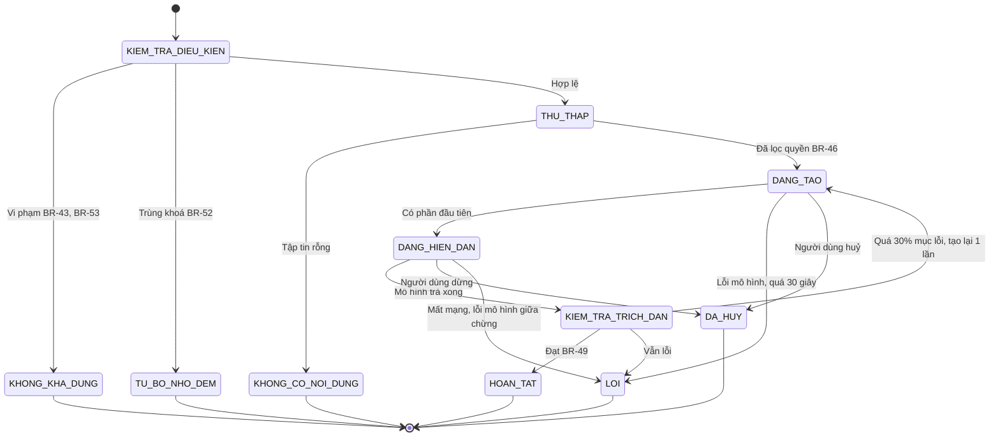
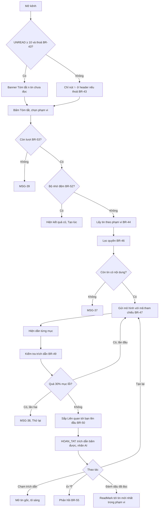
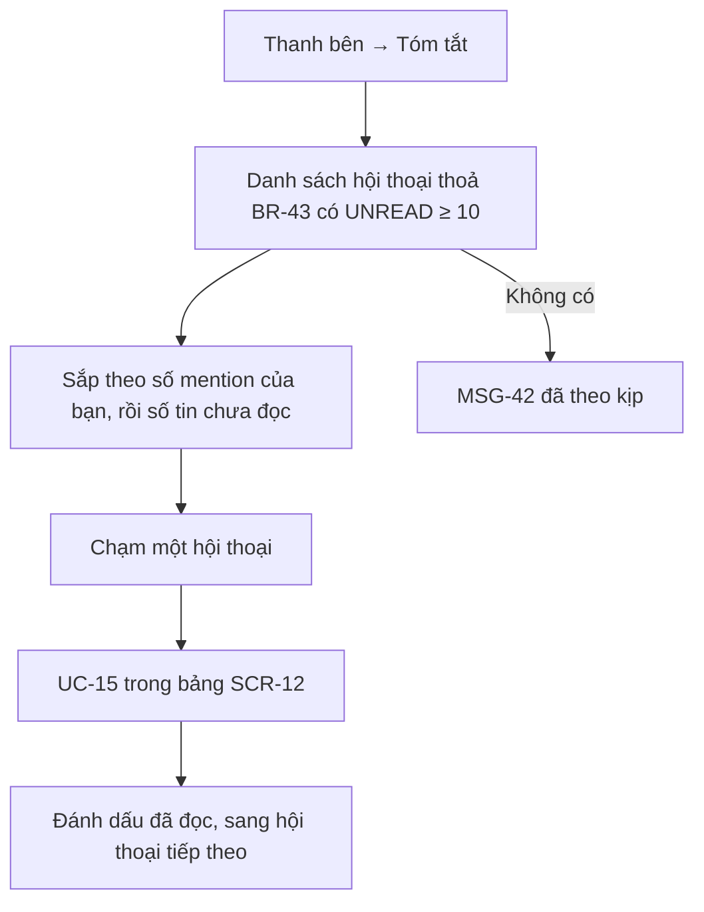
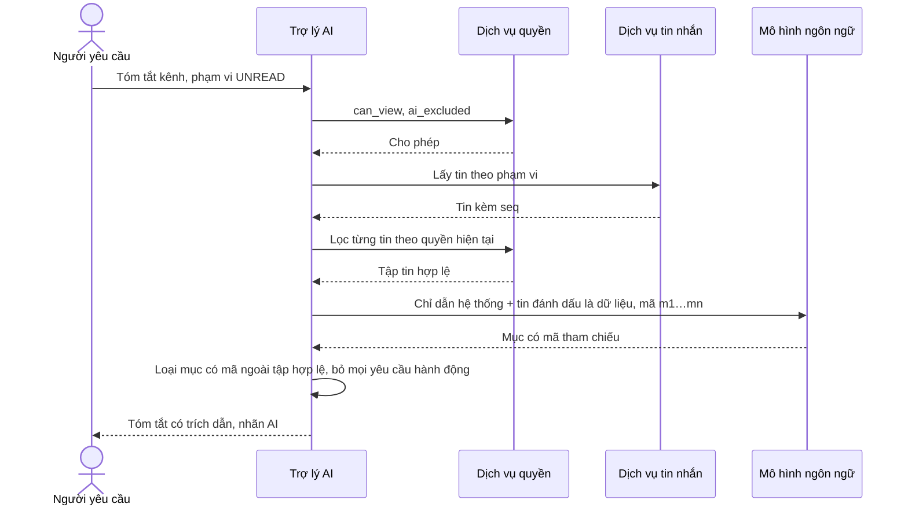

> **Mã:** DE08-TN04-SRS · **Trạng thái:** nháp · **Người viết:** Design (mock) · **PRD:** [PRD.md](PRD.md)

# UC-DE08-04 - AI tóm tắt kênh và thread

> **Bản mock.** Giá trị `[giả định]` cần BA xác nhận. Quyền đọc của AI theo BR-10, BR-14 ở [SRS TN01](../TN01-workspace-kenh-thanh-vien/SRS.md); tin nhắn, mốc đọc theo [SRS TN02](../TN02-nhan-tin-realtime/SRS.md).

## 1. Tổng quan

| **Mục** | **Nội dung** |
| --- | --- |
| Mục tiêu | Tạo tóm tắt có cấu trúc, có trích dẫn, cho tin chưa đọc của kênh, khoảng thời gian, hoặc thread, chỉ từ tin người yêu cầu được xem |
| Actor | Thành viên (người yêu cầu) · App, Web · Trợ lý AI · Dịch vụ quyền · Dịch vụ tin nhắn · Mô hình ngôn ngữ |
| Phạm vi | Gợi ý tóm tắt, yêu cầu, lọc quyền, gọi mô hình, kiểm tra trích dẫn, hiển thị từng phần, bộ nhớ đệm, giới hạn lượt, phản hồi, tạo lại, bảng tóm tắt |
| Ngoài phạm vi | Bản tin theo lịch, tóm tắt file, tóm tắt cuộc gọi, đăng tóm tắt vào kênh |
| Nền tảng | App iOS / Android, Web / Desktop `[giả định]` |
| Figma | `[chưa có]` |

## 2. User Story

| **ID** | **As a** | **I want** | **So that** |
| --- | --- | --- | --- |
| US-19 | Thành viên | Tóm tắt tin chưa đọc của kênh | Theo kịp nhanh |
| US-20 | Thành viên | Thấy việc được giao cho mình trước | Không sót việc |
| US-21 | Thành viên | Mỗi ý có trích dẫn về tin gốc | Kiểm tra được, tin được |
| US-22 | Thành viên vào thread muộn | Tóm tắt thread dài | Hiểu bối cảnh |
| US-23 | Quản trị | AI không đọc kênh bị loại trừ, không vượt quyền người dùng | Bảo vệ dữ liệu |

## 3. Business Rules

| **Mã** | **Quy tắc** |
| --- | --- |
| BR-43 | **Điều kiện dùng**: workspace `ai_enabled = true`; người yêu cầu không phải Khách; hội thoại không thuộc `ai_excluded`; `can_view(người yêu cầu, hội thoại)` |
| BR-44 | **Phạm vi tin**: `UNREAD` (từ `last_read_seq + 1` tới tin mới nhất), `TODAY`, `LAST_7_DAYS`, hoặc `THREAD` (tin gốc + mọi trả lời). Giới hạn 500 tin gần nhất trong phạm vi; vượt → ghi `truncated`, báo MSG-35 |
| BR-45 | **Ngưỡng gợi ý**: banner gợi ý khi `UNREAD` ≥ 10 tin; thread có nút khi ≥ 10 trả lời. Nút ✨ ở header luôn có khi thoả BR-43 |
| BR-46 | **Lọc quyền trước mô hình**: tập tin đưa vào mô hình = tin trong phạm vi BR-44 **và** `can_view` với người yêu cầu tại thời điểm tạo; bỏ tin đã xoá; tin đã sửa dùng bản mới nhất. Không bao giờ đưa vào tin từ hội thoại khác |
| BR-47 | **Đầu vào mô hình**: mỗi tin có mã tham chiếu ngắn (m1, m2…), tên người gửi, thời gian, nội dung văn bản, tên file (không có nội dung file). Nội dung tin được đánh dấu là dữ liệu, không phải chỉ dẫn |
| BR-48 | **Đầu ra có cấu trúc**: `diem_chinh` (≤ 5), `quyet_dinh`, `viec_can_lam` (mô tả, người được giao nếu có, hạn nếu có), `cau_hoi_mo`; mỗi mục ≤ 2 câu và có ≥ 1 mã tham chiếu |
| BR-49 | **Kiểm tra trích dẫn sau khi tạo**: loại mục có mã tham chiếu không thuộc tập BR-46; nếu > 30% mục bị loại → coi là lỗi chất lượng, tự tạo lại 1 lần; vẫn lỗi → MSG-38 `[giả định]` |
| BR-50 | **Liên quan tới bạn**: mục có người được giao là người yêu cầu, hoặc trích dẫn tin mention người yêu cầu → đưa lên đầu, gắn nhãn |
| BR-51 | **Không có nội dung**: mô hình trả về rỗng hoặc tập tin chỉ gồm tin rất ngắn, emoji → hiện MSG-37, không tạo mục |
| BR-52 | **Bộ nhớ đệm**: khoá = (người yêu cầu, hội thoại hoặc thread, phạm vi, `seq` tin mới nhất, phiên bản quyền). Trùng khoá trong 30 phút → trả kết quả cũ, hiện "Tạo lúc {giờ}" |
| BR-53 | **Giới hạn**: 50 lượt mỗi người mỗi ngày (bộ nhớ đệm không tính); vượt → MSG-39 |
| BR-54 | **Riêng tư**: tóm tắt chỉ người yêu cầu thấy; lưu 7 ngày; không dùng tin nhắn, tóm tắt để huấn luyện mô hình; nhật ký ghi (người yêu cầu, hội thoại, phạm vi, số tin, thời gian), không ghi nội dung |
| BR-55 | **Phản hồi**: 👍 hoặc 👎 kèm lý do (Sai thông tin, Thiếu ý quan trọng, Quá dài, Trích dẫn sai, Khác + ghi chú ≤ 200 ký tự); Tạo lại bỏ qua bộ nhớ đệm, tính 1 lượt |

## 4. Trạng thái

### 4.1 Một yêu cầu tóm tắt

| **Trạng thái** | **Hiển thị trên SCR-12** |
| --- | --- |
| `THU_THAP`, `DANG_TAO` | "Đang đọc {n} tin…", khung xương các phần, nút Dừng |
| `DANG_HIEN_DAN` | Các mục hiện dần; trích dẫn hiện xám tới khi kiểm tra xong |
| `HOAN_TAT` | Đầy đủ, trích dẫn bấm được, 👍 👎, Tạo lại, Đánh dấu đã đọc |
| `TU_BO_NHO_DEM` | Như `HOAN_TAT`, thêm "Tạo lúc {giờ}" |
| `KHONG_CO_NOI_DUNG` | MSG-37 |
| `LOI` | MSG-38 + Thử lại |
| `KHONG_KHA_DUNG` | Không hiện nút; hoặc MSG-39, MSG-40 |

## 5. Use Case

### UC-15 Tóm tắt kênh

| **Mục** | **Nội dung** |
| --- | --- |
| Tiền điều kiện | Thoả BR-43 |
| Hậu điều kiện thành công | Tóm tắt `HOAN_TAT` chỉ người yêu cầu thấy, mọi mục có trích dẫn hợp lệ |
| Hậu điều kiện thất bại | `LOI` hoặc `KHONG_CO_NOI_DUNG`; không hiện nội dung chưa kiểm tra như kết quả cuối |

**Luồng chính**

| **Bước** | **Actor** | **Mô tả** |
| --- | --- | --- |
| 1 | Thành viên | Bấm "Tóm tắt" ở banner hoặc ✨ ở header |
| 2 | App | Mở **SCR-12** với phạm vi mặc định `UNREAD` |
| 3 | Trợ lý AI | Kiểm tra BR-43, BR-53, BR-52 |
| 4 | Trợ lý AI | Lấy tin (BR-44); lọc quyền (BR-46); dựng đầu vào (BR-47) |
| 5 | Trợ lý AI | Gọi mô hình; truyền dần kết quả về App |
| 6 | Trợ lý AI | Kiểm tra trích dẫn (BR-49); sắp mục liên quan (BR-50) |
| 7 | App | Hiện `HOAN_TAT`; trích dẫn bấm được |

**Luồng thay thế**

| **Mã** | **Điều kiện** | **Xử lý** |
| --- | --- | --- |
| A1 | Vượt 500 tin | MSG-35 trên đầu tóm tắt |
| A2 | Đổi phạm vi (Hôm nay, 7 ngày) | Tạo yêu cầu mới |
| A3 | Có tin mới trong lúc đang xem tóm tắt | Banner "Có {n} tin mới sau tóm tắt" + Cập nhật |
| A4 | Bấm Dừng khi đang tạo | `DA_HUY`; không tính lượt `[giả định]` |
| A5 | Người dùng mất quyền kênh trong lúc tạo | Huỷ kết quả, MSG-40 |
| A6 | Mở lại tóm tắt đã lưu (BR-54) khi tin được trích đã bị xoá, hoặc người dùng không còn quyền xem tin đó | Kiểm tra lại quyền từng trích dẫn khi mở: trích dẫn hỏng hiện "Tin không còn khả dụng", không hiện đoạn trích; mục giữ nguyên kèm nhãn "Nguồn không còn". Mất quyền cả hội thoại → không mở được tóm tắt, MSG-40 `[giả định]` |

**Luồng lỗi**

| **Mã** | **Điều kiện** | **Xử lý** |
| --- | --- | --- |
| E1 | Mô hình lỗi, quá 30 giây | MSG-38, Thử lại |
| E2 | Kiểm tra trích dẫn thất bại 2 lần | MSG-38 |
| E3 | Mất mạng | MSG-41; giữ phần đã nhận nhưng gắn nhãn "Chưa hoàn tất" |

### UC-16 Tóm tắt thread

| **Bước** | **Actor** | **Mô tả** |
| --- | --- | --- |
| 1 | Thành viên | Ở **SCR-07** thread ≥ 10 trả lời, bấm "Tóm tắt thread" |
| 2 | Trợ lý AI | Như UC-15 với phạm vi `THREAD` |
| 3 | App | Tóm tắt hiện trên đầu thread, thu gọn được, chỉ người yêu cầu thấy |

### UC-17 Bảng tóm tắt cho bạn

### UC-18 Chống chèn lệnh và giữ ranh giới dữ liệu

## 6. Điểm vào

| **Điểm vào** | **Dẫn tới** | **Ghi chú** |
| --- | --- | --- |
| Banner "Tóm tắt {n} tin chưa đọc" ở **SCR-06** | UC-15 | BR-45 |
| Nút ✨ ở header **SCR-06** | UC-15 | |
| Nút "Tóm tắt thread" ở **SCR-07** | UC-16 | |
| Thanh bên → Tóm tắt | UC-17 | |

## 7. Mô tả màn hình

### SCR-12 Bảng tóm tắt AI

| **#** | **Thành phần** | **Loại** | **Hành vi** |
| --- | --- | --- | --- |
| 1 | Đầu bảng | Header | "Tóm tắt #{kênh}"; chọn phạm vi: Chưa đọc · Hôm nay · 7 ngày |
| 2 | Phạm vi đã đọc | Text phụ | "{n} tin từ {giờ, ngày} đến {giờ, ngày}"; MSG-35 khi bị cắt |
| 3 | Liên quan tới bạn | Section nổi bật | Mục theo BR-50 |
| 4 | Điểm chính, Quyết định, Việc cần làm, Câu hỏi mở | Sections | Mỗi mục: 1–2 câu, trích dẫn dạng [1] [2]; việc có ảnh người được giao, hạn |
| 5 | Trích dẫn | Chip số | Rê chuột hoặc giữ lâu: xem trước tin; chạm: mở tin gốc |
| 6 | Nhãn AI | Footer | "Do AI tạo, có thể sai sót · Chỉ bạn thấy tóm tắt này" |
| 7 | Hành động | Buttons | 👍 · 👎 (lý do) · Tạo lại · Đánh dấu đã đọc |
| 8 | Trạng thái | Theo 4.1 | Khung xương, Dừng, lỗi, rỗng |

## 8. API

| **API** | **Request chính** | **Response chính** | **Timeout / retry** `[giả định]` |
| --- | --- | --- | --- |
| \[AiAvailability\] | conversation_id | available, reason, remaining_quota | 2s / 1 lần |
| \[SummaryCreate\] | conversation_id hoặc thread_id, scope, regenerate | summary_id, stream | 30s tổng / không tự retry ở client |
| \[SummaryStream\] | summary_id | Từng mục, trạng thái kiểm tra trích dẫn, kết thúc | Kết nối truyền dần |
| \[SummaryCancel\] | summary_id | – | 2s / 1 lần |
| \[SummaryFeedback\] | summary_id, rating, reason, note | – | 3s / 2 lần |
| \[CitationResolve\] | summary_id, ref | conversation_id, message_id, seq (kiểm tra lại `can_view`) | 2s / 1 lần |
| \[LlmGenerate\] (nội bộ) | system, data (tin có mã), schema | Mục có cấu trúc | 25s / 1 lần theo BR-49 |

## 9. Danh sách thông báo

| **ID** | **Nơi hiện** | **Nội dung (VI)** |
| --- | --- | --- |
| MSG-33 | Banner **SCR-06** | {n} tin chưa đọc. \[✨ Tóm tắt\] |
| MSG-34 | **SCR-12** | Đang đọc {n} tin… |
| MSG-35 | **SCR-12** | Kênh có nhiều tin, đây là tóm tắt 500 tin gần nhất |
| MSG-36 | Footer **SCR-12** | Do AI tạo, có thể sai sót. Chỉ bạn thấy tóm tắt này |
| MSG-37 | **SCR-12** | Không có nội dung đáng chú ý trong các tin này |
| MSG-38 | **SCR-12** | Chưa tạo được tóm tắt đáng tin cậy. \[Thử lại\] |
| MSG-39 | **SCR-12** | Bạn đã dùng hết 50 lượt tóm tắt hôm nay. Vui lòng thử lại vào ngày mai |
| MSG-40 | Tooltip, **SCR-12** | Trợ lý AI không khả dụng ở hội thoại này |
| MSG-41 | **SCR-12** | Mất kết nối, tóm tắt chưa hoàn tất. \[Thử lại\] |
| MSG-42 | **SCR-12** | Bạn đã theo kịp mọi kênh |

Bản EN: `[chờ bổ sung]`.

## 10. Yêu cầu phi chức năng

| **Mục** | **Yêu cầu** `[giả định]` |
| --- | --- |
| Hiệu năng | Mục đầu tiên hiện ≤ 3 giây; hoàn tất ≤ 10 giây (p90) với 200 tin |
| Bảo mật, quyền | Lọc quyền ở máy chủ trước khi gọi mô hình; kiểm tra lại quyền khi mở trích dẫn; kiểm thử tự động đảm bảo không có tin ngoài quyền trong đầu vào |
| An toàn AI | Chống chèn lệnh: tin là dữ liệu, mô hình không có công cụ hành động; kiểm tra trích dẫn (BR-49) |
| Dữ liệu | Nhà cung cấp mô hình không lưu, không huấn luyện; tóm tắt lưu 7 ngày; xoá khi người dùng bị vô hiệu hoá |
| Đánh giá chất lượng | Bộ dữ liệu kiểm thử nội bộ 200 hội thoại mẫu, chấm định kỳ độ chính xác và trích dẫn |
| Tracking | Yêu cầu (phạm vi, số tin), bộ nhớ đệm, thời gian, lỗi, tỉ lệ mục bị loại, bấm trích dẫn, phản hồi, tạo lại |
| Accessibility | Trạng thái đang tạo được thông báo; trích dẫn có nhãn "Nguồn {n}: tin của {người} lúc {giờ}"; không chỉ dùng màu cho nhãn liên quan |
