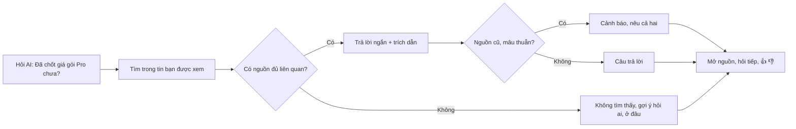

> **Mã:** DE08-TN05-PRD · **Trạng thái:** nháp · **Người viết:** Design (mock) · **SRS:** [SRS.md](SRS.md)

# PRD AI hỏi đáp trên lịch sử tin nhắn (Nhắn tin nội bộ có AI)

> **Bản mock.** Con số đánh dấu `[giả định]` dùng để dựng flow, cần PO xác nhận trước khi dùng.

## 1. Bối cảnh và vấn đề

### 1.1 Bối cảnh

Rất nhiều kiến thức của công ty nằm trong tin nhắn: quyết định về sản phẩm, cách cài môi trường, chính sách nghỉ phép ai đó đã giải thích. Tìm kiếm theo từ khoá ([TN02](../TN02-nhan-tin-realtime/PRD.md)) chỉ hiệu quả khi biết đúng từ. Trợ lý AI cho phép hỏi bằng câu tự nhiên ("Mình đã chốt giá gói Pro chưa?") và trả lời từ lịch sử tin nhắn, có dẫn nguồn, trong phạm vi người hỏi được xem.

### 1.2 Vấn đề

| **Vấn đề** | **Hệ quả** |
| --- | --- |
| Tìm theo từ khoá không ra vì khác cách diễn đạt | Hỏi lại đồng nghiệp, làm phiền người khác |
| Thông tin rải rác nhiều kênh, nhiều tháng | Mất thời gian ghép nối |
| Người mới không biết hỏi ai, hỏi ở đâu | Chậm hoà nhập |
| Câu trả lời AI không có nguồn | Không biết đúng sai, có thể đã lỗi thời |
| AI trả lời từ kênh người hỏi không được xem | Lộ thông tin nhạy cảm |
| AI tự tin trả lời khi không có dữ liệu | Thông tin sai lan truyền |

### 1.3 Mục tiêu

- Câu trả lời đầu tiên xuất hiện ≤ 5 giây `[giả định]`.
- ≥ 70% câu hỏi được đánh giá hữu ích trong số lượt đánh giá `[giả định]`.
- 100% câu trả lời có nguồn, hoặc nói rõ không tìm thấy.
- 0 câu trả lời dùng tin ngoài quyền của người hỏi.

## 2. Người dùng

| **Nhóm** | **Nhu cầu với tính năng này** |
| --- | --- |
| Người mới vào | Hỏi về quy trình, quyết định cũ mà không làm phiền ai |
| Nhân viên lâu năm | Tìm lại "lần trước ta bàn gì về X" |
| Quản lý | Hỏi tình hình dự án qua nhiều kênh |

## 3. Phạm vi

### 3.1 Trong phạm vi (MVP)

- Ô "Hỏi AI" ở thanh bên và trong mỗi kênh (giới hạn trong kênh đó).
- Câu hỏi tiếng Việt và tiếng Anh, bằng ngôn ngữ tự nhiên.
- Phạm vi: mọi hội thoại tôi xem được (mặc định), một kênh, một khoảng thời gian.
- Tìm kiếm ngữ nghĩa kết hợp từ khoá trên tin nhắn người hỏi được xem.
- Câu trả lời ngắn, có trích dẫn nguồn; danh sách nguồn kèm kênh, người, thời gian.
- Nói rõ khi không tìm thấy, khi thông tin có thể đã cũ, khi các nguồn mâu thuẫn.
- Hỏi tiếp trong cùng phiên; lịch sử phiên hỏi đáp của riêng người hỏi.
- Phản hồi 👍 👎.

### 3.2 Ngoài phạm vi

- AI đọc tài liệu, file đính kèm, wiki → phase sau.
- AI thực hiện hành động (gửi tin, tạo việc).
- Chia sẻ câu trả lời AI vào kênh (người dùng tự sao chép).
- Trả lời kiến thức chung không có trong tin nhắn.

## 4. Nguyên tắc sản phẩm

### 4.1 Chỉ trả lời từ những gì bạn được xem

Phạm vi tìm kiếm của AI bằng đúng phạm vi người hỏi được xem, trừ kênh bị loại trừ. Không có ngoại lệ, kể cả với quản trị.

### 4.2 Không có nguồn thì không khẳng định

Mỗi câu khẳng định gắn với trích dẫn. Không tìm thấy thì nói "Mình không tìm thấy…" và gợi ý hỏi ai, ở đâu.

### 4.3 Cho biết độ mới và độ chắc

Câu trả lời ghi thời điểm của nguồn; thông tin cũ hơn 90 ngày có cảnh báo; nguồn mâu thuẫn thì nêu cả hai.

### 4.4 AI là trợ lý, không phải người quyết định

Câu trả lời luôn có nhãn AI; người dùng có thể mở nguồn để đọc nguyên văn.

## 5. Quy tắc nghiệp vụ

| **Quy tắc** | **Giá trị** `[giả định]` |
| --- | --- |
| Độ dài câu hỏi | 3–500 ký tự |
| Phạm vi mặc định | Mọi hội thoại người hỏi xem được, 12 tháng gần nhất |
| Số tin truy xuất | Tối đa 30 đoạn tin liên quan nhất, sau khi lọc quyền |
| Trích dẫn | Mỗi câu khẳng định ≥ 1 nguồn; nguồn phải nằm trong tập đã truy xuất |
| Thông tin cũ | Nguồn mới nhất > 90 ngày → cảnh báo |
| Không đủ dữ liệu | Không có đoạn tin đủ liên quan → trả lời "không tìm thấy" |
| Phiên hỏi đáp | Lưu 30 ngày, chỉ người hỏi thấy; xoá được |
| Giới hạn | 100 câu hỏi mỗi người mỗi ngày |
| Chỉ mục | Tin mới có trong chỉ mục ≤ 5 phút; tin xoá, kênh mất quyền bị gỡ ≤ 5 phút |

- Các giá trị trên là **cấu hình theo workspace**, không cố định trong code.

## 6. Luồng trải nghiệm

| **Bước** | **Giai đoạn** | **Trải nghiệm** | **Đầu ra** |
| --- | --- | --- | --- |
| 1 | Hỏi | Ô Hỏi AI, câu hỏi gợi ý; chọn phạm vi | Câu hỏi |
| 2 | Tìm | "Đang tìm trong các kênh bạn tham gia…" | Nguồn liên quan |
| 3 | Trả lời | Câu trả lời hiện dần, trích dẫn [1] [2] | Câu trả lời |
| 4 | Kiểm tra | Danh sách nguồn: kênh, người, thời gian, đoạn trích; mở tin gốc | Tin tưởng |
| 5 | Hỏi tiếp | Câu hỏi nối tiếp hiểu ngữ cảnh | Làm rõ |
| 6 | Phản hồi | 👍 👎 + lý do | Cải thiện |

## 7. Use Cases, User Stories và Acceptance Criteria

### UC1. Đặt câu hỏi

#### US1.1 Hỏi bằng ngôn ngữ tự nhiên

User Story: Là người mới, tôi muốn hỏi AI về quyết định cũ mà không phải biết đúng từ khoá hay kênh nào.

AC01: Ô Hỏi AI ở thanh bên (phạm vi mọi hội thoại) và trong header mỗi kênh (phạm vi kênh đó).

AC02: Gợi ý câu hỏi mẫu khi ô trống.

AC03: Chọn phạm vi: Tất cả hội thoại của tôi, Kênh hiện tại, Khoảng thời gian.

AC04: Câu hỏi 3–500 ký tự.

### UC2. Nhận câu trả lời

#### US2.1 Câu trả lời có nguồn

User Story: Là thành viên, tôi muốn thấy nguồn của từng câu trả lời để kiểm tra và tin tưởng.

AC01: Câu trả lời ngắn (≤ 150 từ mặc định), hiện dần.

AC02: Mỗi câu khẳng định có trích dẫn [n]; chạm xem trước, mở tin gốc.

AC03: Danh sách nguồn dưới câu trả lời: kênh (khoá nếu riêng tư), người gửi, thời gian, đoạn trích.

AC04: Nhãn "Do AI tạo từ tin nhắn bạn có quyền xem · có thể sai sót".

#### US2.2 Khi không chắc chắn

User Story: Là thành viên, tôi muốn được báo khi không tìm thấy hoặc thông tin đã cũ để không dùng thông tin sai.

AC01: Không có nguồn đủ liên quan → "Mình không tìm thấy thông tin này trong các tin bạn xem được", gợi ý kênh hoặc người có thể biết (chỉ từ hội thoại người hỏi xem được).

AC02: Nguồn mới nhất > 90 ngày → cảnh báo "Thông tin có thể đã cũ (nguồn mới nhất: {ngày})".

AC03: Nguồn mâu thuẫn → nêu cả hai kèm thời gian, không tự chọn.

AC04: Câu hỏi về kiến thức chung, không liên quan tin nhắn → nói rõ chỉ trả lời từ tin nhắn của workspace.

### UC3. Hỏi tiếp và lịch sử

AC01: Hỏi tiếp trong cùng phiên, AI hiểu câu trước ("còn gói Team thì sao?").

AC02: Lịch sử phiên hỏi đáp trong 30 ngày, chỉ người hỏi thấy; xoá từng phiên hoặc tất cả.

AC03: Mở lại phiên cũ → nguồn được kiểm tra lại quyền; nguồn đã mất quyền hiện "Không còn truy cập được".

### UC4. An toàn dữ liệu

AC01: Kết quả không bao giờ dùng tin ngoài quyền người hỏi, kênh loại trừ, tin đã xoá.

AC02: Quản trị không có chế độ "xem mọi thứ" qua AI.

AC03: Khách không dùng được; AI tắt ở workspace thì ẩn toàn bộ.

### UC5. Phản hồi

AC01: 👍 👎; 👎 chọn lý do: Sai, Thiếu, Nguồn không liên quan, Thông tin cũ, Khác.

AC02: Sao chép câu trả lời kèm link nguồn.

## 8. Chỉ số theo dõi `[giả định]`

| **Chỉ số** | **Định nghĩa** | **Mục tiêu MVP** |
| --- | --- | --- |
| Thời gian chữ đầu tiên | Từ gửi câu hỏi tới chữ đầu tiên | ≤ 5 giây (p90) |
| Tỉ lệ hữu ích | 👍 / (👍 + 👎) | ≥ 70% |
| Tỉ lệ "không tìm thấy" | Câu trả lời không tìm thấy / câu hỏi | Theo dõi; quá thấp là dấu hiệu AI trả lời gượng |
| Tỉ lệ mở nguồn | Câu trả lời có ≥ 1 lượt mở nguồn / câu trả lời | Theo dõi |
| Độ chính xác trích dẫn | Câu khẳng định được nguồn hỗ trợ (kiểm tra mẫu) | ≥ 90% |
| Vi phạm quyền | Câu trả lời dùng tin ngoài quyền | 0 |

## 9. Phụ thuộc và rủi ro

| **Mục** | **Mô tả** | **Hướng xử lý** |
| --- | --- | --- |
| Chỉ mục ngữ nghĩa lệch quyền | Chỉ mục trả về tin người hỏi không xem được | Lọc quyền ở truy vấn chỉ mục và lọc lại sau truy xuất |
| Chỉ mục chậm cập nhật | Tin xoá vẫn được trả lời | Gỡ khỏi chỉ mục ≤ 5 phút; kiểm tra tin còn tồn tại trước khi đưa vào mô hình |
| AI bịa | Câu trả lời sai có vẻ đúng | Bắt buộc trích dẫn; kiểm tra nguồn; trả lời "không tìm thấy" khi độ liên quan thấp |
| Chèn lệnh qua tin nhắn | Tin chứa chỉ dẫn độc hại | Tin là dữ liệu; mô hình không có công cụ hành động |
| Chi phí | Câu hỏi phạm vi rộng | Giới hạn 30 đoạn, 100 câu mỗi ngày, bộ nhớ đệm truy xuất |

## 10. Câu hỏi mở

- Có cho AI gợi ý tên người có thể biết câu trả lời không (rủi ro làm phiền)?
- Phạm vi mặc định 12 tháng có phù hợp?
- Có lưu câu hỏi để thống kê chủ đề hay hỏi (ẩn danh) không?
- Có cần chế độ trả lời dài, chi tiết?
