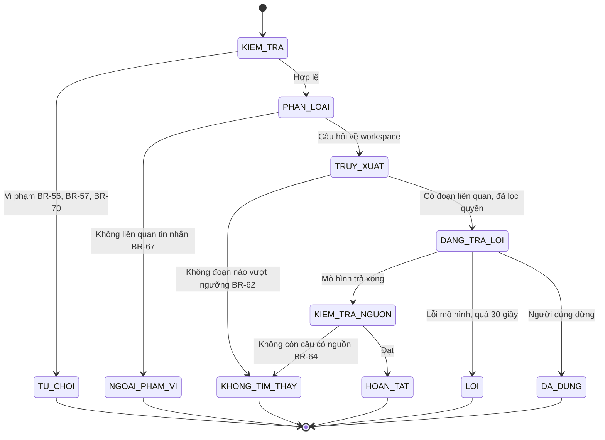
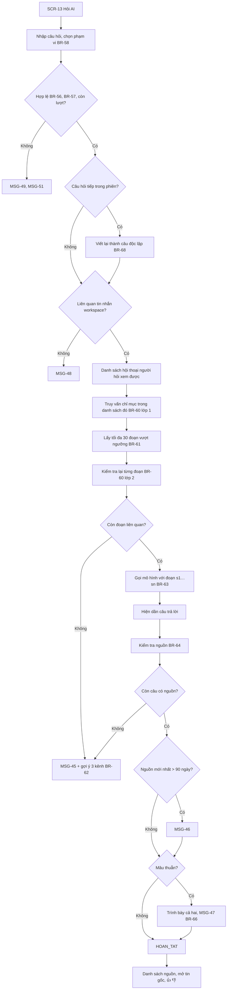
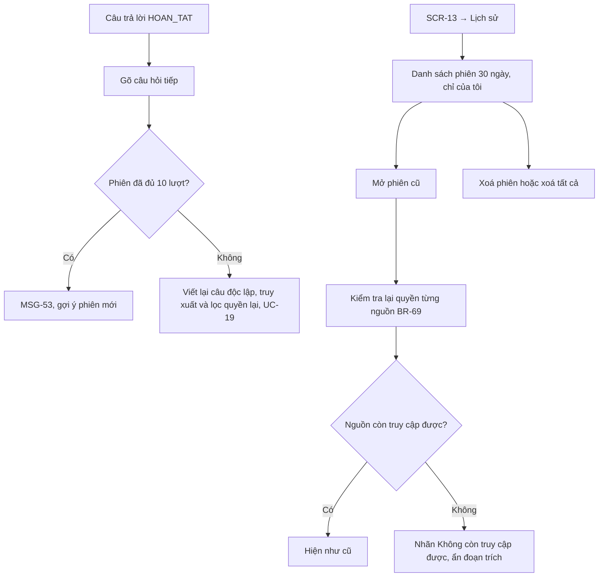
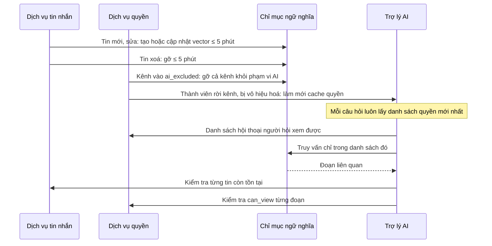
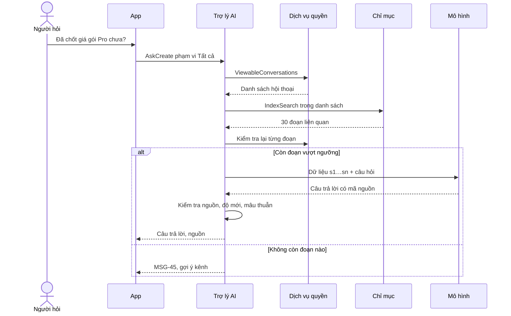

> **Mã:** DE08-TN05-SRS · **Trạng thái:** nháp · **Người viết:** Design (mock) · **PRD:** [PRD.md](PRD.md)

# UC-DE08-05 - AI hỏi đáp trên lịch sử tin nhắn

> **Bản mock.** Giá trị `[giả định]` cần BA xác nhận. Điều kiện dùng AI và quyền đọc theo BR-10, BR-14 ở [SRS TN01](../TN01-workspace-kenh-thanh-vien/SRS.md); kiểm tra trích dẫn tương tự BR-49 ở [SRS TN04](../TN04-ai-tom-tat/SRS.md).

## 1. Tổng quan

| **Mục** | **Nội dung** |
| --- | --- |
| Mục tiêu | Người dùng hỏi bằng ngôn ngữ tự nhiên, nhận câu trả lời có trích dẫn từ tin nhắn mình được xem; AI nói rõ khi không tìm thấy, thông tin cũ, nguồn mâu thuẫn |
| Actor | Thành viên (người hỏi) · App, Web · Trợ lý AI · Dịch vụ quyền · Chỉ mục tìm kiếm ngữ nghĩa · Dịch vụ tin nhắn · Mô hình ngôn ngữ |
| Phạm vi | Ô hỏi, phạm vi, truy xuất lai (ngữ nghĩa + từ khoá), lọc quyền, ngưỡng liên quan, sinh câu trả lời, kiểm tra trích dẫn, cảnh báo độ mới, mâu thuẫn, hỏi tiếp, lịch sử phiên, phản hồi, cập nhật chỉ mục |
| Ngoài phạm vi | Đọc file, wiki; hành động; chia sẻ câu trả lời vào kênh; kiến thức chung |
| Nền tảng | App iOS / Android, Web / Desktop `[giả định]` |
| Figma | `[chưa có]` |

## 2. User Story

| **ID** | **As a** | **I want** | **So that** |
| --- | --- | --- | --- |
| US-24 | Thành viên | Hỏi bằng câu tự nhiên | Tìm được dù không biết từ khoá |
| US-25 | Thành viên | Thấy nguồn của từng câu trả lời | Kiểm tra, tin tưởng |
| US-26 | Thành viên | Được báo khi không tìm thấy hoặc thông tin cũ | Không dùng thông tin sai |
| US-27 | Thành viên | Hỏi tiếp trong cùng ngữ cảnh | Làm rõ nhanh |
| US-28 | Quản trị | AI không bao giờ vượt quyền người hỏi | Giữ an toàn dữ liệu |

## 3. Business Rules

| **Mã** | **Quy tắc** |
| --- | --- |
| BR-56 | **Điều kiện dùng** giống BR-43: `ai_enabled`, không phải Khách; phạm vi một kênh thì kênh đó phải thoả `can_view` và không `ai_excluded` |
| BR-57 | **Câu hỏi** 3–500 ký tự; tiếng Việt hoặc tiếng Anh; câu trả lời theo ngôn ngữ câu hỏi |
| BR-58 | **Phạm vi**: `TAT_CA` (mọi hội thoại thoả BR-10 với người hỏi, trừ `ai_excluded`), `KENH` (một kênh), kèm khoảng thời gian (mặc định 12 tháng gần nhất; tối đa toàn bộ lịch sử) |
| BR-59 | **Chỉ mục**: mỗi tin (hoặc đoạn ≤ 800 ký tự của tin dài) có vector ngữ nghĩa, từ khoá, `conversation_id`, `seq`, thời gian, người gửi. Tin mới vào chỉ mục ≤ 5 phút; tin sửa cập nhật, tin xoá và kênh `ai_excluded` gỡ khỏi chỉ mục ≤ 5 phút |
| BR-60 | **Lọc quyền hai lớp**: (1) truy vấn chỉ mục chỉ trong danh sách `conversation_id` người hỏi xem được tại thời điểm hỏi; (2) sau truy xuất, kiểm tra lại từng đoạn: tin còn tồn tại, `can_view` còn đúng. Đoạn trượt lớp 2 bị bỏ và ghi cảnh báo nội bộ |
| BR-61 | **Truy xuất lai**: kết hợp điểm ngữ nghĩa và từ khoá; lấy tối đa 30 đoạn có điểm ≥ ngưỡng liên quan `[giả định]`; kèm 2 tin trước, sau mỗi đoạn trong cùng hội thoại làm ngữ cảnh (cũng qua lọc quyền) |
| BR-62 | **Không đủ dữ liệu**: không đoạn nào vượt ngưỡng → không gọi mô hình sinh câu trả lời; trả MSG-45 kèm gợi ý tối đa 3 kênh liên quan nhất người hỏi xem được |
| BR-63 | **Sinh câu trả lời**: mô hình chỉ dùng đoạn được cung cấp (mã s1…sn), đánh dấu là dữ liệu; mỗi câu khẳng định gắn mã nguồn; câu trả lời ≤ 150 từ mặc định; nếu dữ liệu không đủ → trả `khong_du_thong_tin` |
| BR-64 | **Kiểm tra trích dẫn**: bỏ câu có mã nguồn ngoài tập cung cấp; câu trả lời còn < 1 câu có nguồn → coi như không tìm thấy (MSG-45) |
| BR-65 | **Cảnh báo độ mới**: nguồn mới nhất được trích dẫn cũ hơn 90 ngày → MSG-46 kèm ngày |
| BR-66 | **Mâu thuẫn**: mô hình đánh dấu `mau_thuan` khi các nguồn khác nhau về cùng điểm → trình bày cả hai kèm thời gian, nguồn mới hơn đặt trước, không tự kết luận (MSG-47) |
| BR-67 | **Ngoài phạm vi**: câu hỏi không liên quan tin nhắn workspace (kiến thức chung, yêu cầu viết hộ) → MSG-48, không sinh nội dung ngoài |
| BR-68 | **Hỏi tiếp**: phiên giữ tối đa 10 lượt hỏi đáp; câu hỏi mới được viết lại thành câu độc lập từ ngữ cảnh phiên rồi mới truy xuất; mỗi lượt truy xuất lại và lọc quyền lại |
| BR-69 | **Lịch sử phiên**: chỉ người hỏi thấy; lưu 30 ngày; xoá từng phiên hoặc tất cả. Mở phiên cũ → kiểm tra lại quyền từng nguồn; nguồn mất quyền hiện "Không còn truy cập được", không hiện đoạn trích |
| BR-70 | **Giới hạn và dữ liệu**: 100 câu hỏi mỗi người mỗi ngày (MSG-49); không dùng tin nhắn, câu hỏi để huấn luyện mô hình; nhật ký ghi người hỏi, phạm vi, số đoạn, thời gian, không ghi nội dung câu hỏi `[giả định]` |

## 4. Trạng thái

### 4.1 Một lượt hỏi đáp

| **Trạng thái** | **Hiển thị trên SCR-13** |
| --- | --- |
| `TRUY_XUAT` | "Đang tìm trong {phạm vi}…" |
| `DANG_TRA_LOI` | Chữ hiện dần; trích dẫn xám tới khi kiểm tra xong; nút Dừng |
| `HOAN_TAT` | Câu trả lời, trích dẫn, danh sách nguồn, cảnh báo độ mới, mâu thuẫn nếu có, 👍 👎, Sao chép |
| `KHONG_TIM_THAY` | MSG-45 + gợi ý kênh |
| `NGOAI_PHAM_VI` | MSG-48 |
| `LOI` | MSG-50 + Thử lại |

## 5. Use Case

### UC-19 Hỏi và nhận câu trả lời

| **Mục** | **Nội dung** |
| --- | --- |
| Tiền điều kiện | Thoả BR-56 |
| Hậu điều kiện thành công | Câu trả lời `HOAN_TAT`, mọi câu khẳng định có nguồn hợp lệ trong quyền người hỏi |
| Hậu điều kiện thất bại | `KHONG_TIM_THAY`, `NGOAI_PHAM_VI` hoặc `LOI`; không hiện khẳng định không có nguồn |

**Luồng chính**

| **Bước** | **Actor** | **Mô tả** |
| --- | --- | --- |
| 1 | Thành viên | Mở **SCR-13**, nhập câu hỏi, chọn phạm vi (mặc định Tất cả) |
| 2 | Trợ lý AI | Kiểm tra BR-56, BR-57, BR-70; phân loại BR-67 |
| 3 | Trợ lý AI | Lấy danh sách hội thoại xem được; truy vấn chỉ mục (BR-60 lớp 1, BR-61) |
| 4 | Trợ lý AI | Kiểm tra lại từng đoạn (BR-60 lớp 2) |
| 5 | Trợ lý AI | Gọi mô hình (BR-63); truyền dần về App |
| 6 | Trợ lý AI | Kiểm tra nguồn (BR-64); gắn cảnh báo (BR-65, BR-66) |
| 7 | App | Hiện câu trả lời, trích dẫn, danh sách nguồn |

**Luồng thay thế**

| **Mã** | **Điều kiện** | **Xử lý** |
| --- | --- | --- |
| A1 | Hỏi từ header kênh | Phạm vi `KENH`, đổi sang Tất cả được |
| A2 | Không tìm thấy | MSG-45 với gợi ý kênh (chỉ kênh người hỏi xem được) |
| A3 | Câu hỏi kiến thức chung | MSG-48 |
| A4 | Bấm Dừng | `DA_DUNG`, giữ phần đã hiện kèm nhãn "Chưa hoàn tất", không hiện trích dẫn chưa kiểm tra |
| A5 | Đổi khoảng thời gian | Truy xuất lại |

**Luồng lỗi**

| **Mã** | **Điều kiện** | **Xử lý** |
| --- | --- | --- |
| E1 | Mô hình lỗi, quá 30 giây | MSG-50, Thử lại |
| E2 | Chỉ mục không khả dụng | MSG-52, gợi ý dùng tìm kiếm từ khoá (TN02) |
| E3 | Đoạn trượt lớp 2 (quyền đổi giữa chừng) | Bỏ đoạn; vẫn trả lời nếu còn đủ đoạn; ghi cảnh báo nội bộ |

### UC-20 Hỏi tiếp và lịch sử phiên

### UC-21 Cập nhật chỉ mục theo thay đổi dữ liệu và quyền

## 6. Điểm vào

| **Điểm vào** | **Dẫn tới** | **Ghi chú** |
| --- | --- | --- |
| Thanh bên → Hỏi AI | UC-19, phạm vi Tất cả | |
| Header kênh → ✨ → Hỏi về kênh này | UC-19, phạm vi Kênh | |
| Phím tắt (Web) | **SCR-13** | `[giả định]` Ctrl/Cmd + J |
| Nguồn trong câu trả lời | **SCR-06** nhảy tới tin | Kiểm tra lại `can_view` |
| Lịch sử phiên | UC-20 | |

## 7. Mô tả màn hình

### SCR-13 Hỏi trợ lý AI

| **#** | **Thành phần** | **Loại** | **Hành vi** |
| --- | --- | --- | --- |
| 1 | Ô câu hỏi | Text | 3–500 ký tự; Enter gửi |
| 2 | Phạm vi | Chips | Tất cả hội thoại của tôi · #{kênh hiện tại} · Khoảng thời gian (12 tháng mặc định) |
| 3 | Gợi ý câu hỏi | List | Khi ô trống: ví dụ "Quy trình xin nghỉ phép là gì?", "Tuần trước team đã chốt gì về {kênh}?" |
| 4 | Câu trả lời | Card | Văn bản có trích dẫn [n]; nhãn AI; cảnh báo MSG-46, MSG-47 khi có |
| 5 | Nguồn | List | Mỗi nguồn: biểu tượng kênh (khoá nếu riêng tư), tên kênh, người gửi, thời gian, đoạn trích ≤ 200 ký tự; Mở tin |
| 6 | Hành động | Buttons | 👍 · 👎 (lý do) · Sao chép (kèm link nguồn) · Dừng (khi đang tạo) |
| 7 | Hỏi tiếp | Ô dưới cùng | BR-68 |
| 8 | Lịch sử | Panel | Phiên 30 ngày; xoá |
| 9 | Trạng thái | Theo 4.1 | Đang tìm, đang trả lời, không tìm thấy, lỗi |

## 8. API

| **API** | **Request chính** | **Response chính** | **Timeout / retry** `[giả định]` |
| --- | --- | --- | --- |
| \[AskCreate\] | question, scope, conversation_id, time_range, session_id | answer_id, stream | 30s tổng / không tự retry ở client |
| \[AskStream\] | answer_id | Văn bản dần, trạng thái, nguồn đã kiểm tra, cờ stale, conflict | Kết nối truyền dần |
| \[AskStop\] | answer_id | – | 2s / 1 lần |
| \[AskFeedback\] | answer_id, rating, reason, note | – | 3s / 2 lần |
| \[SessionList\], \[SessionGet\], \[SessionDelete\] | session_id | Phiên, lượt, nguồn đã kiểm tra lại quyền | 3s / 1 lần |
| \[ViewableConversations\] (nội bộ) | user_id | Danh sách conversation_id thoả BR-10, trừ ai_excluded | 200 ms, cache 60 giây, xoá khi quyền đổi |
| \[IndexSearch\] (nội bộ) | query, conversation_ids, time_range, k | Đoạn, điểm | 2s / 1 lần |
| \[IndexUpsert\], \[IndexDelete\] (nội bộ) | message, chunk | – | Hàng đợi, ≤ 5 phút |
| \[LlmGenerate\] (nội bộ) | system, data (s1…sn), question, schema | Câu có mã nguồn, cờ | 25s / 1 lần |

## 9. Danh sách thông báo

| **ID** | **Nơi hiện** | **Nội dung (VI)** |
| --- | --- | --- |
| MSG-43 | **SCR-13** | Đang tìm trong {các kênh bạn tham gia / #{kênh}}… |
| MSG-44 | Nhãn câu trả lời | Do AI tạo từ tin nhắn bạn có quyền xem, có thể sai sót |
| MSG-45 | **SCR-13** | Mình không tìm thấy thông tin này trong các tin bạn xem được. Bạn có thể hỏi trong: {tối đa 3 kênh} |
| MSG-46 | Cảnh báo | Thông tin có thể đã cũ, nguồn mới nhất từ {ngày} |
| MSG-47 | Cảnh báo | Các tin nhắn chưa thống nhất về điểm này. Dưới đây là cả hai thông tin, mới nhất trước |
| MSG-48 | **SCR-13** | Mình chỉ trả lời dựa trên tin nhắn trong {workspace}. Câu hỏi này có vẻ nằm ngoài phạm vi đó |
| MSG-49 | **SCR-13** | Bạn đã dùng hết 100 câu hỏi hôm nay. Vui lòng thử lại vào ngày mai |
| MSG-50 | **SCR-13** | Chưa trả lời được lúc này. \[Thử lại\] |
| MSG-51 | Inline | Câu hỏi cần từ 3 đến 500 ký tự |
| MSG-52 | **SCR-13** | Tìm kiếm AI đang gián đoạn. Bạn có thể dùng tìm kiếm thường trong lúc chờ |
| MSG-53 | **SCR-13** | Phiên này đã dài, hãy bắt đầu phiên mới để có câu trả lời chính xác hơn. \[Phiên mới\] |
| MSG-54 | Nguồn | Không còn truy cập được |

Bản EN: `[chờ bổ sung]`.

## 10. Yêu cầu phi chức năng

| **Mục** | **Yêu cầu** `[giả định]` |
| --- | --- |
| Hiệu năng | Chữ đầu tiên ≤ 5 giây (p90); truy xuất ≤ 2 giây; hoàn tất ≤ 15 giây |
| Bảo mật, quyền | Lọc quyền hai lớp (BR-60); kiểm thử tự động với tài khoản thử ở nhiều mức quyền, khẳng định 0 đoạn ngoài quyền; không có đường vượt quyền cho quản trị |
| An toàn AI | Tin là dữ liệu, mô hình không có công cụ; kiểm tra trích dẫn; ưu tiên "không tìm thấy" hơn trả lời gượng |
| Dữ liệu | Không huấn luyện; lịch sử phiên 30 ngày; xoá khi người dùng bị vô hiệu hoá; nhật ký không chứa nội dung |
| Chỉ mục | Độ trễ cập nhật ≤ 5 phút; giám sát số tin chưa vào chỉ mục |
| Đánh giá chất lượng | Bộ câu hỏi kiểm thử có đáp án và nguồn đúng; chấm định kỳ độ chính xác, tỉ lệ "không tìm thấy" đúng |
| Tracking | Câu hỏi (phạm vi, ngôn ngữ), số đoạn, không tìm thấy, ngoài phạm vi, độ mới, mâu thuẫn, mở nguồn, phản hồi, hỏi tiếp, xoá phiên |
| Accessibility | Câu trả lời đọc được bằng trình đọc màn hình kèm "Nguồn {n}"; trạng thái đang tìm được thông báo; cảnh báo có biểu tượng và chữ |
